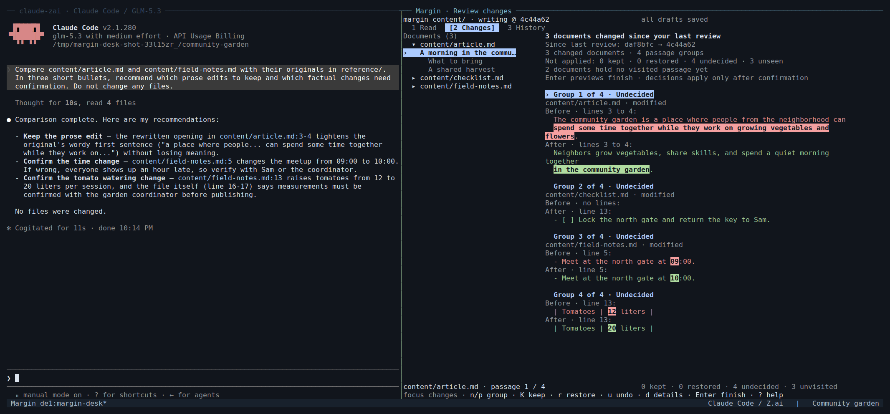

# Margin

A terminal workspace for Markdown writing, agent edits, and passage-by-passage review, backed by Git.

Edit a document yourself or work beside an agent. Save drafts in ordinary Git
history, inspect what changed, and keep or restore individual passages.



*Margin desk with Claude Code connected to Z.ai (GLM-5.3).
The agent recommends edits on the left. Margin shows changed passages and
review controls on the right. You can also use Margin without an agent.*

## What you can do

- **Write:** edit Markdown source with autosave, selection, undo, and recovery.
- **Review:** compare before and after, keep clearer prose, and restore unwanted changes.
- **Work with an agent:** request edits to selected text while you continue writing.
- **Browse history:** read earlier versions and restore a document through a new commit.
- **Control the scope:** choose which Markdown files Margin captures and reviews.

Saving, checkpointing, and reviewing are separate actions:

| Action | Result |
| --- | --- |
| Save | Write the current text to the working file |
| Checkpoint | Preserve the writing scope in a Git commit |
| Review | Apply keep or restore decisions and record the review |

Saving and checkpointing never approve changes. Agent results still need review.

## Install

You need Git and Rust with Cargo. The repository pins its Rust toolchain
in `rust-toolchain.toml`. The optional desk also needs tmux 3.1 or newer.

```bash
git clone https://github.com/nibzard/margin.git
cd margin
cargo install --path . --locked
margin --help
```

Cargo installs `margin` in its binary directory, usually `~/.cargo/bin`.
Add that directory to your `PATH` if your shell cannot find the command.
See the [support matrix](docs/verification-tiers.md) for tested platforms and versions.

## Try it with example documents

Run these commands from the cloned Margin repository in one Bash session.
They create a separate temporary Git repository.

```bash
MARGIN_EXAMPLES="$PWD/examples"
MARGIN_DEMO=$(mktemp -d "${TMPDIR:-/tmp}/margin-demo.XXXXXX")
mkdir -p "$MARGIN_DEMO/content"
cp "$MARGIN_EXAMPLES"/before/*.md "$MARGIN_DEMO/content/"
cd "$MARGIN_DEMO"
git init -b writing
git config --local user.name "Demo Writer"
git config --local user.email "demo@example.test"
margin init --scope content/
```

Apply the supplied edits, checkpoint them, and open the review:

```bash
cp "$MARGIN_EXAMPLES"/after/*.md content/
margin checkpoint --message "Revise the garden documents"
margin tui --view changes
```

In **Changes**, use `n` and `p` to move between passage groups.
Press `K` to keep a change or `r` to restore its earlier text.
Press `Enter` to inspect the finish summary, then `Enter` again to apply it.
**Undecided changes are kept when you confirm.**

The examples include a shorter opening and unconfirmed changes to times and
measurements. Try keeping the opening and restoring the facts.
See the [full walkthrough](examples/README.md) for scripted review and historical restoration.

## Use your own writing project

From an existing Git repository, choose a directory of Markdown documents:

```bash
margin init --scope content/
margin tui
```

Replace `content/` with your writing directory. Initialization records its
starting point. Files outside the writing scope stay outside capture and review.
Use `margin status` to check what is saved and what still needs review.

Open a document directly with `margin content/article.md`. Paths are relative
to the repository root.

### Edit and navigate

Press `e` in **Read** to edit Markdown source. Margin saves after a
750-millisecond pause. Press `Esc` to save and return to reading.
Switching documents retains your cursor and undo history.
Press `C` in reading to checkpoint the writing scope and open **Changes**.
This retains review decisions for unchanged patches and reports retained and
reset counts. Changed or uncertain groups return to undecided.

| Key in the reading or review interface | Action |
| --- | --- |
| `1` / `2` / `3` | Open Read / Changes / History |
| `Tab` / `Shift+Tab` | Move focus between interface areas |
| `f` | Find and open a document |
| `/` | Search the current view |
| `Ctrl+F` | Search source across the workspace |
| `:` | Open the action menu; press `/` inside it to filter |
| `?` | Open contextual help |
| `]` in Changes | Jump to the next undecided group |
| `E` in Read | Open the configured external editor |

While editing, use `F1` for help. Ordinary keys insert text instead of running
reading or review actions. `Ctrl+Z` and `Ctrl+Y` undo and redo source edits.
Use Shift with movement to select text.

You can click documents, headings, tabs, and change groups. Click a reading
passage to edit it. The wheel scrolls; in the editor, it leaves the cursor in place.
Inside tmux, pointer input needs your `mouse on` setting. Margin does not change it.
Hold Shift for your terminal's text selection.

To configure an external editor, for example Neovim:

```bash
margin init --editor-argv-json '["nvim", "--"]'
margin edit --path content/article.md
```

See the [editing guide](docs/source-editing.md) for all editor shortcuts,
save conflicts, recovery, and source-size limits.

### Work beside an agent

Run an installed agent beside Margin in a tmux desk:

```bash
margin desk -- claude
```

Replace `claude` with your agent's executable and arguments. Margin does not
install or authenticate the agent. The screenshot uses Claude Code configured
for Z.ai; that provider is optional.

Inside tmux, the desk adds a window. Outside tmux, it creates and attaches to
a dedicated session. Narrow terminals use separate windows instead of split
panes. Quitting Margin leaves the agent running. Without tmux, run `margin tui`
and your agent in separate terminal tabs.

To request an edit, select source and press `F2`. Type an instruction and press
`Enter`. An empty selection requests the whole document. Margin saves the latest
text before creating the request. You can continue writing while the agent works.

**The agent must use Margin's request commands to return a result.**
Other edits to files are treated as external changes. For Claude Code, install
the optional integration from your writing repository:

```bash
margin hook install claude --dry-run
margin hook install claude
```

The installer adds local hook settings and managed guidance in `CLAUDE.md` and
`AGENTS.md`. It preserves unrelated settings and refuses to replace edited
guidance blocks. Starting a desk alone does not install this integration.
Queued requests reach Claude Code on your next prompt; they do not interrupt
an active turn. Other agents can use the [request commands](docs/source-editing.md#generic-agent-commands).

Results preserve supported separate edits and pause on conflicts. In the editor,
`F6` shows conflict details, `F3` uses the proposal, and `F4` keeps your text.
`Ctrl+U` undoes the latest applied agent edit when later changes would not be overwritten.
Press `B` in reading to inspect requests.

An agent can also show you a document without taking keyboard focus:

```bash
margin open content/article.md --line 42
```

Run this command from the desk's agent pane. See the [desk link guide](docs/desk-links.md)
for clickable links and terminal setup.

## Command-line workflows

Use `--help` on any command for its options and `--json` for structured results.

| Command | Purpose |
| --- | --- |
| `margin status` | Inspect capture and review state |
| `margin checkpoint --message "Revise the opening"` | Save a draft commit |
| `margin diff` | Compare the draft with the last valid review baseline |
| `margin diff --working` | Inspect working changes before checkpointing |
| `margin review --input review.json --dry-run` | Preview a review plan |
| `margin review --input review.json` | Apply the review plan |
| `margin log` | Browse writing history |
| `margin show --path content/article.md --revision HEAD` | Read a saved document |
| `margin restore --input restore.json` | Restore a historical document through a new commit |
| `margin note --text "Keep the concrete example"` | Attach feedback to the current checkpoint |
| `margin requests list --json` | Inspect agent requests |
| `margin doctor` | Inspect recovery state |

Review plans use identifiers from `margin diff --json`. Repeating a completed
review or restoration request returns its receipt. Historical restoration leaves
the restored content pending review. The [example walkthrough](examples/README.md)
builds valid plans from your repository's current history.

## Status and limitations

Margin is under active development. Try it in the disposable example repository
before adopting it for your writing.

- Source editing, review, history, and agent requests are implemented.
- Linked Git worktrees remain inspection-only.
- Source editing supports files up to 1 MiB. Use an external editor for larger files.
- Conflict checks cannot prevent every race with unrelated editors or Git commands.
- Physical terminal link checks and pointer hover remain open work.

See the [documentation and plan index](docs/README.md) for delivery status and
[remaining work](docs/remaining-gaps-plan.md). [to-do.json](to-do.json) is a backlog
snapshot and can lag current implementation.

## Build and test

Run these commands from the Margin repository:

```bash
cargo build --locked
cargo test --all-targets --locked
```

Tests use temporary Git repositories to check content, history, scope, and recovery.
The desk suite needs tmux 3.1 or newer. It skips with a notice when tmux is unavailable.
Set `MARGIN_REQUIRE_TMUX=1` to make missing tmux a failure.

The continuous integration (CI) workflow runs pull-request and nightly verification tiers.
See [CI setup](ci/README.md), the [support matrix](docs/verification-tiers.md),
and the [terminal smoke matrix](docs/terminal-smoke-matrix.md) for requirements and evidence.

## Documentation

- [Example walkthrough](examples/README.md)
- [Source editing, agent requests, and recovery](docs/source-editing.md)
- [Behavior and design specification](SPEC.md)
- [Notes and feedback](docs/notes-channel.md)
- [Review plan schema](schemas/review-plan-v1.json)
- [Notes schema](schemas/notes-v1.json)
- [Formal review model](formal/MarginReview.tla) and [mutation checks](formal/mutations/README.md)

## License

Licensed under the [Apache License 2.0](LICENSE).
