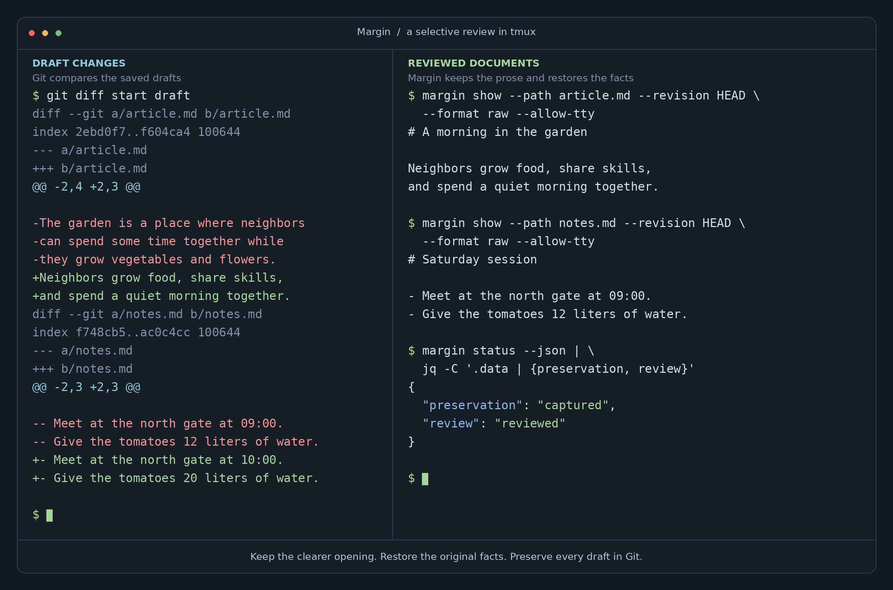

# Margin

Save and review Markdown edits through ordinary Git history.



*Example review in tmux. Git shows the draft changes on the left. Margin
shows the reviewed documents on the right: keep the shorter opening and
restore the original facts.*

Margin is a command-line tool for writing projects. Capture a draft,
inspect its changes, then keep or restore selected passages.

## Quick start

You need Git and Rust with Cargo. The repository pins its Rust toolchain
in `rust-toolchain.toml`.

```bash
git clone https://github.com/nibzard/margin.git
cd margin
cargo install --path . --locked
margin --help
```

Cargo installs `margin` in its binary directory. Add that directory to
your `PATH` if your shell cannot find the command.

Try the included documents in a separate repository:

```bash
MARGIN_DEMO=$(mktemp -d "${TMPDIR:-/tmp}/margin-demo.XXXXXX")
mkdir -p "$MARGIN_DEMO/content"
cp examples/before/*.md "$MARGIN_DEMO/content/"
cd "$MARGIN_DEMO"
git init -b writing
git config --local user.name "Demo Writer"
git config --local user.email "demo@example.test"
margin init --scope content/
margin status
```

Edit a file in `content/`, then save and inspect the draft:

```bash
margin checkpoint --message "Revise the garden documents"
margin diff
```

Follow the [example walkthrough](examples/README.md) to try selective review,
request retries, and historical restoration. It includes original and edited
documents plus commands that build review plans from your current history.

## How it works

Margin tracks preservation and review separately. A checkpoint saves your
draft. A review records your decisions about that draft.

| Command | Purpose |
| --- | --- |
| `margin init --scope content/` | Adopt a writing scope and record its starting point |
| `margin status` | See whether scoped content is captured and reviewed |
| `margin checkpoint` | Save scoped edits as a draft commit |
| `margin diff` | Inspect changes since the last valid review baseline |
| `margin review --input review.json --dry-run` | Preview the decisions in a review plan |
| `margin review --input review.json` | Keep or restore changes and record the review |
| `margin log` | Browse the writing history |
| `margin tui` | Open the interactive reading and review surface |
| `margin content/article.md` | Open one document in the interactive surface |
| `margin edit --path content/article.md` | Hand one document to the configured editor |
| `margin show --path content/article.md --revision HEAD` | Read a saved document |
| `margin restore --input restore.json` | Restore one historical document in a new commit |
| `margin doctor` | Inspect recovery state |
| `margin hook claude` | Translate one Claude Code hook event into a capture |
| `margin hook install claude` | Add Margin's hook entries to the local Claude Code settings |
| `margin hook remove claude` | Delete Margin's hook entries from the local Claude Code settings |
| `margin desk -- claude` | Compose an optional tmux desk with the agent beside Margin |

Review plans use identifiers from `margin diff --json`. A completed request
has a receipt in Git history. Repeating the same request returns that receipt.
Historical restoration creates a new commit and leaves the restored content
pending review.

Open a document directly with `margin content/article.md`, shorthand for
`margin tui --path content/article.md`. Paths are relative to the repository
root. The shorthand accepts TUI options, such as `--view changes`.

The hook adapter reads one Claude Code hook event from standard input and
answers in Claude Code's own hook protocol, never in the Margin envelope. It
captures one ordinary draft only while `--auto-checkpoint` is stored, uses a
generic commit reason, and never blocks a Stop, so it cannot keep an agent
running. A missing or malformed event captures and approves nothing.

Install the entries with `margin hook install claude`; remove them with
`margin hook remove claude`. Both commands edit only
`.claude/settings.local.json`, leave every unrelated key and user hook in
place, reread the file before writing and refuse when it changed under
them, and report a repeated run as a no-op. Add `--dry-run` to see the
exact planned configuration and the adapter capabilities first.

`margin desk -- claude` composes an optional tmux writing desk around an
explicit agent command line. Outside tmux it creates a dedicated detached
session, attaches it, and detaches back to the same shell when you press
the session's prefix and `d`. Inside an existing session it adds one
clearly named window and leaves every other pane alone. The agent argv
runs through tmux direct execution, so each argument stays one argument
and no shell reads it. Terminals narrower than 140 columns get one
command per window instead of two unreadable columns. The desk edits no
global tmux option, sends no keystrokes into any pane, and reports the
processes it created, the session's own prefix key (queried, never
assumed), and how to reattach. You own the agent process: quitting Margin
or closing its pane leaves the agent running. Without tmux, `desk`
refuses with the two-tab arrangement instead — run `margin tui` in one
tab and the agent in another.

Use `--json` for structured command results. Use `--help` on any command
for its options. Files outside the writing scope stay outside Margin's
capture and review operations.

## Development status

The implementation is in progress. Core command-line workflows are available
for testing. The interactive terminal interface opens with its Read view,
its Changes view, and its History view. Persistent tabs show the active view.
The compact sidebar nests the selected document's Markdown headings. `Tab`
focuses the outline, `j`/`k` or arrows jump between entries, and `Enter` returns
to reading. Left/right fold or expand the document; `[` hides or shows the
sidebar. Scrolling highlights the current section. HTML comments stay hidden
in Read until `s` toggles source view; source-line anchors survive both
navigation and resizing.

Changes shows before/after passages with word-level emphasis. `K` and `r`
record an in-memory keep or restore decision; `u` clears the selected decision.
`d` shows grouping rationale and review identity; `s` shows exact source.
The decision count is separate from document saving: decisions are **not
applied** until confirmed. `Enter` opens a finish summary of the entire writing
scope, and a second `Enter` keeps the remaining changes and records the review
through the same operation as `margin review`.

Notes explain changes without changing document content. After a checkpoint,
agents use `margin note --text "Why this changed"`, optionally with
`--group` and a `change_id` from `margin diff --json`. `margin notes --json`
lists notes on HEAD; `--revision` selects an earlier commit, and
`margin notes --schema` exports the envelope schema. Changes and History
display notes with authorship in words. In Changes, `N` opens a writer note;
`Enter` saves it and `Esc` cancels. Installing the Claude integration adds
the marked discovery block to `CLAUDE.md` and `AGENTS.md`; edited blocks
are preserved with a conflict. Prompt hooks deliver bounded writer feedback
from the current adoption's history, including feedback on older candidates.

History lists versions affecting the selected document, in ancestry order,
with separate local date, short commit, and description columns. `d` reveals
revision kind, full commit, and exact timestamp; `a` expands draft checkpoints.
`Enter` previews restoration against the current candidate before a second
`Enter` applies it through `margin restore`. The review baseline stays
unchanged, and missing files stay distinct from empty ones.

The keyboard contract of the interface is complete: `Tab` and `Shift-Tab`
cycle focus between the document list, the reading column, and the standing
action menu, and the footer names the focused element in words; `PgUp` and
`PgDn` move one viewport, less one held row, in the focused element; `:` opens
every action with its binding and the reason a disabled action cannot run;
`?` lists the contextual keys and the current blockers; `/` searches within
the current view and `f` opens the document picker, and inside those fields
ordinary characters are text, so `Enter` submits the field rather than
finishing a review and one bracketed paste never fires a sequence of global
actions. `e` hands the displayed document to the configured editor (set one
with `margin init --editor-argv-json`), the editor meets a cooked terminal,
and its return reloads the document. An editor exit never approves; it
captures one draft only while `--capture-after-edit` is stored. While the
surface is open, its two-second polling keeps the displayed document and
the document list current with the working tree: changed bytes reload in
place with the reading position kept, and arrived or deleted documents
join and leave the list; a pinned review comparison never re-pins itself.
Every state is labeled in words and symbols, never hue alone, and
`--color never` draws a plain monochrome surface. `--reduced-updates`
redraws only when the frame changed, for terminals and assistive setups
sensitive to redraws. The surface restores raw mode, the alternate screen,
bracketed paste, and cursor visibility on quit, `Ctrl-C`, terminal errors,
resize, and editor return; an uncatchable kill can run no cleanup, so a
terminal left raw after one recovers with `reset` (or `stty sane`). The
`edit` command hands one document to the same configured editor from the
command line. The Claude Code hook adapter translates supported events, and
`hook install` and `hook remove` edit only Margin's own entries in the local
Claude Code settings; `margin desk` composes the optional tmux writing desk.

`Ctrl+F` searches the working source of every document listed in the TUI.
Type a literal, case-insensitive query and press `Enter`; results show file
paths, source lines, and excerpts. Use arrows to select a result and `Enter`
to open it at that line in source view. `Ctrl+F` returns to the results;
inside the panel it reruns the search. Editing the query clears old results,
and `Esc` cancels and closes. Search runs in the background, changes no
content, and reports skipped files and limits: 256 KiB per file, 16 MiB total,
2,000 files, and 500 matching lines. Binary, unreadable, and symlinked files
are skipped. `/` continues to search only the current view.
Recovery supports inspection, exact-plan review resume, and guarded capture
of inspected staged content.

Known defects and remaining work are recorded in [to-do.json](to-do.json).
That file is a backlog snapshot; regenerate it at integration milestones.
Use the disposable example repository when evaluating the current behavior.

## Build and test

Run these commands from the Margin repository:

```bash
cargo build --locked
cargo test --all-targets --locked
```

The tests use temporary Git repositories to check file content, history,
scope boundaries, receipts, and failure behavior.

The tmux desk suite needs tmux 3.1 or newer: direct execution after `--`
and percentage pane sizes both arrived in that release. The suite skips
with a notice where no usable tmux exists. The CI tiers install the
pinned release with `ci/install-tmux.sh` and set `MARGIN_REQUIRE_TMUX=1`,
which turns a missing tmux into a failure. See [CI tier support](ci/README.md).

The repository runs two verification tiers, a pull-request tier and a
nightly tier, through `ci/run-tier.sh`; the claimed Rust, Git, Linux,
and macOS versions and the evidence behind them are recorded in
[Verification tiers and support matrix](docs/verification-tiers.md).

For more detail, see:

- [Examples and demonstration](examples/README.md)
- [Behavior and design specification](SPEC.md)
- [Supported terminal smoke matrix](docs/terminal-smoke-matrix.md)
- [Verification tiers and support matrix](docs/verification-tiers.md)
- [The notes channel design](docs/notes-channel.md)
- [Review plan schema](schemas/review-plan-v1.json)
- [Notes schema](schemas/notes-v1.json)
- [Formal model](formal/MarginReview.tla)
- [Formal mutation checks](formal/mutations/README.md)
- [Implementation backlog](to-do.json)

## License

Licensed under the [Apache License 2.0](LICENSE).

### Open documents from the agent pane

Inside `margin desk -- claude` (or any shell-capable agent), run
`margin open notes/article.md` to switch the existing viewer without moving
keyboard focus. `margin open notes/article.md --line 42` selects source view;
`--json` returns the usual command envelope. Paths are repository-relative and
must be eligible for the viewer's current scope. Opening changes no content,
checkpoint, or review decisions. Close pending dialogs or the external editor
before opening another document. A closed viewer requires a new desk.

Add this instruction to your agent guidance if useful:

> When asked to show a document in Margin, find its repository-relative path and
> run `margin open PATH`. Use `--line N` for a particular passage.

Each desk passes a private `MARGIN_DESK_SOCKET` to its agent and viewer. The
viewer owns cleanup; detaching and reattaching preserves the connection, including
when narrow layouts put Margin in its own window. No agent configuration is
changed. Clickable terminal links are a future integration.
