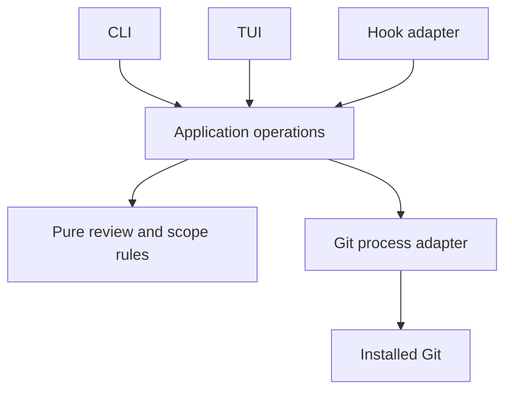

# Margin

## Product, system design, formal specification, and development contract

**One-line pitch:** A terminal writing desk that makes agent edits readable, reviewable, and reversible, with Git keeping the history.

| Field | Value |
| --- | --- |
| Working product name | Margin |
| Specification version | 0.1 |
| Date | 2026-10-09 |
| Status | Proposed implementation contract; no product implementation or performance results are claimed |
| Implementation | Rust; one Cargo package with a library and executable |
| Human interface | A modern terminal user interface |
| Agent interface | A documented, noninteractive CLI with versioned JSON |
| Durable history | Ordinary commits in the user's Git repository |
| Design method | Domain-driven design, DRY, KISS, test-driven development, formal modeling, and benchmark-driven decisions |

This specification supersedes the earlier browser-interface and private-history-store proposals. The CLI-first, Git-native direction is authoritative. The application will add editorial understanding and review policy to existing tools.

**Evidence status:** Requirements, commands, schemas, budgets, and architecture below are design decisions. References support statements about existing tools. All numeric performance and usability thresholds are initial acceptance budgets, not measurements. Appendix A contains an executable-form TLA+ model and TLC configurations; its validation status is stated separately from the required future model-checking gates.

### Reading guide

| Reader | Start with |
| --- | --- |
| Product and design | Sections 1–5, 11, 17, and 20 |
| CLI and agent integration | Sections 6–9 and 12 |
| Rust implementation | Sections 8–16 and 19 |
| Verification and release | Sections 14–20 and Appendix A |

### Contents

1. Jobs to be done and product outcome
2. First principles and product boundary
3. Scope and supported operating conditions
4. Domain model and invariants
5. Writer experience and interaction design
6. CLI command contract
7. Machine data and error contracts
8. Git history, scope, and review metadata
9. Mutation algorithms and recovery
10. Markdown comparison and restoration
11. Terminal presentation and accessibility
12. Agent hooks, editor, and tmux integration
13. Rust architecture and dependency policy
14. Reliability, trust, and security boundaries
15. Formal specification and refinement obligations
16. Automated test strategy
17. Benchmarks, metrics, and acceptance budgets
18. Development workflow and CI
19. Delivery slices and acceptance scenarios
20. Architecture decisions and release checklist
21. References
Appendix A. TLA+ module, model configurations, and verification notes

## 1. Jobs to be done and product outcome

### 1.1 Primary writer job

> When an agent edits my writing, help me understand the changes, preserve my voice, and recover earlier wording without interrupting my writing flow.

The central outcome is informed control over a document. Attractive highlighting is useful only if it helps the writer identify, assess, and reverse edits accurately.

| Situation | Job | Observable successful outcome |
| --- | --- | --- |
| An agent completes a writing pass | Understand its net effect since my last review | Identify changed claims, wording, links, and structure without rereading every document |
| Most edits are useful | Keep the improvements and restore an unwanted passage | Produce the intended combination while preserving both earlier drafts |
| Several passes happen before I review | Assess the current result without processing overlapping queues | One comparison against the last reviewed scope |
| A useful sentence disappeared | Recover earlier wording | Find, read, copy, or restore the earlier revision |
| I switch between drafting and review | Keep the same document context | Return to the relevant document and passage with minimal navigation |
| Saving fails | Know what is actually preserved | See the last committed revision and the remaining working changes |

The emotional job is confidence to delegate writing while retaining authorship and judgment. The product must not equate a successful agent run, a Git commit, or a rendered preview with editorial approval.

### 1.2 Agent job

> Give me a small, predictable command interface for inspecting drafts, saving writing passes, and performing review operations explicitly delegated by the writer.

An agent must be able to discover commands, inspect state, submit a complete plan, identify a stale request, and recover without reading terminal decoration or guessing whether a mutation succeeded.

### 1.3 Everyday loop

Ask the agent to revise → save the writing pass automatically at a configured boundary → read the changes → keep or restore → continue writing.

Saving requires no per-pass confirmation once automatic checkpointing is enabled. Review remains an explicit action. History remains available through Git after Margin is removed.

### 1.4 Product success

Success means that writers correctly understand changes and produce the result they intended, and agents complete supported CLI workflows with few commands and no unintended mutations. Section 17 defines the measurements and thresholds. Snapshot count, lines of code, and test coverage percentage are diagnostic data, not product success metrics.

## 2. First principles and product boundary

### 2.1 Responsibility allocation

| Responsibility | Existing foundation | Margin's responsibility |
| --- | --- | --- |
| Document format | Markdown files | Preserve source and make changes readable |
| Durable versions | Git commits, trees, and blobs | Present an editorial timeline and documented review markers |
| Source difference calculation | Git diff | Group complete patches into understandable review passages |
| Patch application | Git apply and index | Validate plans, scope, expected versions, and outcomes |
| Text editing | The writer's terminal editor and CLI agent | Open the correct file and refresh afterward |
| Terminal layout | Terminal emulator and optional tmux | Offer a small ready-made workspace arrangement |
| Review decisions | Margin | Pin context, collect decisions, apply the intended result, record approval |

Git exposes stable porcelain status and patch application interfaces suitable for these foundations. Margin will use the installed Git executable through an argument-vector process interface. [G1][G3]

### 2.2 Design principles

**P-01 — Source is authoritative.** Rendering never reserializes Markdown. Display wrapping never edits source wrapping.

**P-02 — Git is the history.** There is one repository history, consisting of ordinary commits on an ordinary adopted branch. There is no parallel history database, private bare repository, shadow branch, or proprietary snapshot format.

**P-03 — Capture and approval are separate.** A draft checkpoint preserves content. A valid review commit identifies the exact approved result. An external commit does not automatically approve anything.

**P-04 — CLI operations are the product contract.** CLI, TUI, and hooks use the same application operations and validators. The TUI calls them in process.

**P-05 — Bounded and explicit behavior.** Machine outputs state their scope, version identities, completeness, and mutation effects. Missing decisions do not become approval.

**P-06 — Minimal dependencies, not hand-built infrastructure.** Reuse Git and a small terminal/parser/serialization stack. Every additional shipped dependency requires an architectural reason and measured cost.

**P-07 — Honest failure.** A failed multi-step operation may leave working-tree or index changes. Report those states precisely and preserve the committed recovery anchor.

**P-08 — Optimize demonstrated problems.** Establish correctness and benchmark baselines before optimizing. Each optimization must improve a named metric without weakening invariants.

### 2.3 Release 0.1 includes

- Explicit adoption of a writing scope and branch, with a saved starting point.
- Ordinary draft checkpoints, including opt-in automatic checkpoints at supported agent boundaries.
- Read, Changes, and History views in one TUI.
- Word-oriented highlights with exact source fallback.
- Restoration of complete safe change groups, followed by explicit whole-scope review.
- Whole-document restoration from history as a new unreviewed draft.
- A noninteractive CLI with typed JSON, dry runs, stale guards, and documented retries.
- External editor handoff, one Claude Code hook adapter, and optional tmux composition.
- Real-Git tests, formal model checks, reproducible benchmarks, and agent/writer evaluations.

### 2.4 Deliberately deferred

Built-in editing, chat, an embedded terminal, browser or desktop interfaces, arbitrary word-level acceptance, per-document review baselines, generalized plugins, multiple simultaneous writers, cloud synchronization, publishing, semantic claim verification, automatic rename tracking, and multi-repository operations are outside release 0.1.

No LLM API is required by the application. Agents remain external programs. Model access is used only by optional development-time AX evaluations.

## 3. Scope and supported operating conditions

### 3.1 Initial support envelope

| Concern | Release 0.1 policy |
| --- | --- |
| Platforms | Linux and macOS on explicitly tested releases; other platforms get no mutation guarantee until their test matrix passes |
| Repository | Local, non-bare Git repository with one conventional working tree |
| Branch | One explicitly adopted attached branch per repository configuration |
| Filesystem | Local filesystem; network mounts and synchronizing remote filesystems are outside the supported mutation envelope |
| Writing scope | One canonical set of included path roots, exclusions, and Markdown suffixes |
| Writers | One cooperating active writer during a mutation |
| Git index | Clean against HEAD before normal mutations; exact-plan resume and staged-state recovery checkpoint are the two explicit exceptions in Section 9.7 |
| Git operations | No active merge, rebase, cherry-pick, revert, bisect-driven checkout, or unresolved conflict |
| Repository extensions | Linked worktrees, sparse checkout, shallow/partial clones with unavailable objects, and nested repositories are inspection-only until explicitly supported |
| Content transformations | Only the identity storage profile in Section 8.8 is supported for mutations |
| Hooks | Existing Git hooks are honored; hooks that modify the intended commit or working files violate the supported mutation contract |
| Scale | Acceptance envelope: 1,000 documents and 100 MiB of scoped source, with larger inputs handled through explicit limits |

The implementation must detect unsupported conditions before normal mutation, explain the specific blocker, and retain read-only inspection where practical. It must not silently lower its guarantees.

### 3.2 Scope definition

The scope descriptor contains a version, normalized repository-relative include roots, exclude roots, allowed suffixes, and fixed path/content policy identifiers. Release 0.1 accepts literal directories or exact file paths; it does not introduce a glob language.

Example canonical scope descriptor:

```json
{"v":1,"include":["content/"],"exclude":["content/private/"],"suffixes":[".markdown",".md"],"path_policy":"literal-utf8-v1","storage_policy":"identity-v1"}
```

Rules:

1. Resolve a user-supplied scope relative to the selected repository root. Reject escaping `..`, absolute paths, NUL, and any symlink component.
2. Normalize separators and redundant `.` components, use `./` for the repository root, sort entries by UTF-8 bytes, remove duplicate or redundant roots, and preserve filename case. Suffix matching is ASCII case-insensitive.
3. Include tracked matching files even if an ignore rule now matches them. Include untracked matching files only when Git does not ignore them. Never force-add ignored files implicitly.
4. Determine comparisons from the union of scoped paths in baseline and candidate. A deletion remains part of review even though its working file no longer exists.
5. Reject symlinks, submodules, nested repository roots, and unsupported path encodings as actionable scope blockers. Do not silently pretend they were reviewed.
6. Added or deleted files are whole-file change groups. Renames are deletion plus addition.
7. Scope changes require explicit reinitialization and a new starting marker. Approval from an old scope never carries into a different scope implicitly.

The JSON descriptor is a convention readable by ordinary tools. It is configuration and commit metadata, not a replacement history format.

### 3.3 Path and size limits

Spaces, quotes, newlines, leading dashes, and Unicode in valid UTF-8 filenames must be supported using literal path arguments and NUL-delimited Git protocols. Non-UTF-8 pathnames are reported explicitly and block adoption of a scope that includes them; release 0.1 will not invent an ambiguous JSON path encoding.

A document up to 1 MiB is eligible for the full rendered comparison. A larger document, up to the initial 16 MiB per-file limit, uses a bounded source/whole-file view. Oversized files produce `LIMIT_EXCEEDED` and remain unapproved; they are never silently omitted. Limits are configuration values included in inspection results, with changes requiring explicit user action. Documents containing non-UTF-8 bytes can be preserved as opaque Git content and reviewed only as whole-file changes; the UI must distinguish this from readable source.

## 4. Domain model and invariants

### 4.1 Ubiquitous language

| Term | Definition |
| --- | --- |
| Workspace | The selected working tree, its adopted branch, and local Margin configuration |
| Scope | The canonical document selection and storage policy |
| Document | A scoped repository-relative file path; absence and an empty file are different states |
| Revision | An immutable Git commit object |
| Starting point | The initial scoped content captured at adoption; a comparison anchor, not approval |
| Checkpoint | A draft commit preserving a writing boundary; unchanged captures are no-ops |
| Baseline, B | The last valid review result for this scope, or its starting point |
| Candidate, C | The immutable current HEAD commit selected for a review |
| Working content, W | The current on-disk scoped files, potentially newer than C |
| Change group | One or more complete Git patch units safe to restore together |
| Review | A pinned B/C/scope/engine comparison with a complete change manifest |
| Review plan | Explicit keep/restore choices, preconditions, and a request identifier |
| Result, R | The scoped content obtained by applying the plan to C |
| Result tree, T | The complete Git tree intended for the new commit, including unchanged out-of-scope entries |
| Receipt | A valid ordinary commit whose trailers identify a completed mutation request |
| Restoration | An explicit creation of new current content from earlier Git content |

### 4.2 Three related states, never one overloaded flag

| Dimension | Values | Meaning |
| --- | --- | --- |
| Preservation | `captured`, `uncaptured`, `unknown` | Whether the observed scoped working content is in the selected candidate |
| Review | `starting_point`, `reviewed`, `pending`, `blocked` | Whether scoped differences remain against a valid approved baseline |
| Operation | `idle`, `validating`, `applying`, `committing`, `recovery_required`, `outcome_unknown` | What a mutation is doing or what must be inspected |

A document can be saved and unreviewed. A previously reviewed commit can coexist with newer unsaved work. A valid historical receipt does not imply that current HEAD or the working tree is reviewed.

### 4.3 Required invariants

| ID | Invariant |
| --- | --- |
| INV-01 | Every successful checkpoint is recoverable as ordinary committed Git content; unchanged checkpoint responses explicitly report a no-op |
| INV-02 | A checkpoint, external commit, hook event, or working-tree refresh cannot advance the approved baseline |
| INV-03 | A review is pinned to baseline, candidate, scope, branch, complete patch manifest, and engine contract |
| INV-04 | Keeping every change reproduces the candidate's scoped Git content and modes exactly |
| INV-05 | Restoring every change reproduces the baseline's scoped Git content, modes, and file presence exactly |
| INV-06 | Selective restoration modifies only selected complete change groups; every other scoped byte/mode/presence stays at C |
| INV-07 | A successful Margin commit leaves the out-of-scope tree equal to its candidate parent |
| INV-08 | An observed stale candidate, branch, scope, index, or working state causes refusal before the first intended mutation |
| INV-09 | Only a structurally valid review marker binding the intended result to the actual commit can advance the baseline |
| INV-10 | Repeating a completed review/restoration request with the same fingerprint returns its receipt without another mutation; a changed fingerprint fails |
| INV-11 | Restoration appends history and never moves a branch backwards, amends history, or erases the source revision |
| INV-12 | Display and query commands do not change working files, staged selections, or refs; disposable computation and non-authoritative caches are permitted |
| INV-13 | Failure, timeout, or crash cannot be reported as a confirmed success unless the resulting commit and metadata have been verified |
| INV-14 | An incomplete or truncated presentation cannot silently become a narrower review scope or omit undisplayed changes from approval counts |
| INV-15 | Restart never invents prior decisions or automatically approves a partially applied result |

These are guarantees within Section 3's operating assumptions. In particular, checking a hash and subsequently applying a patch does not exclude arbitrary external writers. The formal model makes that assumption visible instead of disguising it as a lock guarantee.

## 5. Writer experience and interaction design

### 5.1 First use

Opening `margin tui` is read-only until adoption. It shows the discovered folder and documents and offers a concise setup action. The equivalent CLI is:

```sh
margin init --scope content/ --auto-checkpoint --json
margin hook install claude --dry-run --json
margin hook install claude --json
margin tui
```

`init` is explicit authorization to create a starting commit for the displayed scope and store local settings. `--auto-checkpoint` enables future configured capture boundaries. Without that flag, preservation is manual until explicitly enabled. Installing hooks is a distinct explicit action and preserves unrelated configuration.

Existing scoped working content is the starting point, including eligible untracked files. Existing staged changes block setup. The starting commit may be empty if the current tree is already saved. It establishes a comparison anchor and does not claim the writing has been reviewed.

For a new folder, `margin init --create-repo --scope .` may invoke ordinary `git init` and create the initial scoped commit. It never creates an identity on the writer's behalf. Missing Git author/committer configuration is an actionable setup error. In an existing repository, Margin adopts the current branch and never switches it automatically. `--branch` acts as an expected-branch assertion there; with `--create-repo`, it names the initial branch.

Unborn initialization requires an empty index, computes from Git's empty tree, and permits exactly one zero-parent `start` commit with `Margin-Candidate: unborn`. It includes only the eligible scoped entries. The same rules apply to an existing empty Git repository. Every later Margin commit has one parent.

After the commit is verified, show: **“Your starting draft is saved. Continue with your agent.”** Earlier uncaptured versions are not implied to exist.

### 5.2 Writing pass and review

The optional daily launcher is:

```sh
margin desk -- claude
```

The agent and Margin occupy separate terminal panes when there is space. The agent edits ordinary files. A configured hook checkpoints the pass. The TUI displays **“3 documents changed since your last review.”**

Changes opens a single reading column with headings, changed passages, additions, deletions, and an always-available source view. A passage action reads **Restore previous passage**, not “reject hunk.” The action changes a proposed result in memory. Files are modified only when the review is applied.

The default finish action summarizes the entire writing scope: documents affected, passages restored, and changes kept, including unvisited documents. The writer explicitly chooses **Keep remaining changes and finish**. No unvisited change is silently excluded or approved by navigating away.

If everything is good, **Keep all changes** records a review commit, including an empty commit when needed. No new save confirmation is required. If the writer quits before finishing, their draft is still saved; unapplied selections are discarded only after a clear notice when any exist.

### 5.3 New edits during review

The displayed B/C pair is immutable. On observing a new HEAD, dirty scoped file, scope change, or changed eligibility, show **“New edits arrived. Refresh before applying.”** Disable application of the old plan. Continue allowing the writer to read it.

Refresh rebuilds the review and resets unapplied selections with a notice. Selection migration is deferred. A disabled finish button must explain whether the blocker is new content, staged changes, active writing, or unsupported repository state.

### 5.4 Three views

| View | Purpose | State retained when switching |
| --- | --- | --- |
| Changes | Review B → C, with proposed restorations | Document, source anchor, selected change, and plan |
| Read | Read C or an explicitly labeled working preview | Document and nearest source anchor |
| History | Browse Git revisions and compare or restore a document | Document, selected revision, and nearest source anchor |

Uncaptured working content is labeled **Unsaved draft** and has no actionable review ID. **Save draft** invokes checkpoint. The TUI never pretends its polling saved the file. While the surface is open, polling keeps the displayed document and the document list current with the working tree: new bytes reload in place through the same label rule an interactive load uses, and the reading position survives the swap (SPEC 13.3).

### 5.5 History and restoration

History emphasizes starting points, writing passes, reviews, and restorations. It can collapse draft checkpoints without deleting or hiding their availability. Timestamps are displayed locally with an exact timestamp available; order is Git ancestry, not clock sorting.

Whole-document history restoration first shows a preview against current C. It then creates an ordinary restoration commit. It does **not** approve the rest of the scope or advance its review baseline. The resulting scope is reviewed through the normal Changes workflow.

If current changes are not committed, offer **Save current draft, then preview restoration** under the configured save policy. The preview and final command must use the newly captured candidate. Files missing in one revision are displayed as missing, not empty.

### 5.6 External editing

Edit suspends the TUI and opens the file in an explicitly configured editor argv. When the editor exits, restore the terminal, inspect current state, and return to the document. In a tmux desk, an optional editor window can occupy the writing side. The application does not implement editor buffers, cursor semantics, or undo.

No source content, title, or suggested feedback is inserted into a shell command. Copy feedback is a manual, sanitized text action; it does not send a prompt to an agent automatically.

## 6. CLI command contract

### 6.1 General rules

Nibzard's AX guidance treats commands, help, output structure, exits, and recovery behavior as a single interface. Margin adopts that framing and verifies it through task evaluations instead of treating a JSON flag as sufficient evidence. [A1][A2]

Core commands are noninteractive in every mode. Required intent is expressed through arguments or structured input. Missing data produces a typed error. The TUI is the only interactive product interface; it gathers input before calling the same operation.

Global options:

| Option | Contract |
| --- | --- |
| `--json` | One versioned JSON envelope on stdout; no decoration or prompts |
| `--cwd PATH` | Select repository discovery root; all returned paths remain repository-relative |
| `--timeout-ms N` | Bounded execution budget, default 10,000 ms for core commands; a timeout triggers outcome inspection |
| `--color auto\|always\|never` | Text-mode decoration only; JSON always has no ANSI escapes |
| `--help` | Concise usage, arguments, examples, mutation behavior, and exit classes |
| `--help --json` | Structured command help suitable for discovery |
| `--version --json` | Build, schema, engine, and Git capability information |

There is no hidden pager, editor, credential flow, or spinner in machine mode. `--json` is detected before normal argument-error reporting, so syntax failures use the same JSON envelope. Clap errors must be caught rather than allowed to terminate through default printing. [R1]

This is Margin's own interface guarantee. The supported Git mutation environment also requires hooks and signing tools that can complete noninteractively within the configured budget. Margin closes unused stdin and bounds child execution; it cannot prevent arbitrary inherited hook code from accessing a controlling terminal. It reports such a blocker or uncertain timeout instead of silently bypassing the hook/signing policy.

### 6.2 Command inventory

| Command | Key inputs | Output / effect |
| --- | --- | --- |
| `init` | `--scope`, repeatable `--exclude`, capture/editor settings, optional `--create-repo`, `--branch`, `--new-start`, `--dry-run` | Adopt scope, capture starting point, record local settings |
| `status` | Optional `--path` presentation filter | Preservation/review state, identities, counts, limits, and blockers |
| `diff` | Optional `--path`, `--change`, `--cursor`, `--limit`, `--working` | Complete review identity/manifest plus bounded selected detail; working previews are non-actionable |
| `show` | `--path`, `--revision`, optional byte/page bounds | Document at an immutable revision; explicit absence/encoding |
| `log` | `--limit`, `--cursor`, optional `--path`, `--all-checkpoints` | Bounded ancestry-based editorial timeline |
| `note` | `--text`, optional `--group` | Guarded append of one agent note to the candidate commit |
| `notes` | Optional `--revision`, `--json`; alternative `--schema` | List a commit's notes (default HEAD), or print the installed notes-v1 schema without repository access |
| `checkpoint` | Optional message, expected state, `--dry-run`; guarded `--include-staged` recovery mode | Ordinary draft commit or explicit unchanged no-op |
| `review` | `--input FILE\|-`, optional `--dry-run` or `--resume` | Validate or apply a complete pinned review plan |
| `restore` | `--input FILE\|-`, optional `--dry-run` | Whole-document historical restoration as an unreviewed commit |
| `doctor` | Optional `--json` | Read-only diagnostics and bounded recovery argv suggestions |
| `tui` | Optional initial document/view | Interactive review surface |
| `edit` | `--path`; configured editor argv | Explicit terminal editor handoff |
| `desk` | `-- AGENT ARGS...` | Optional tmux arrangement and explicit child process launch |
| `hook install\|remove claude` | Optional `--dry-run` | Exact integration configuration changes |
| `hook claude` | Hook protocol JSON on stdin | Translate a supported Claude hook to a capture operation |

The hook adapter uses the upstream hook protocol, not the normal Margin JSON envelope. Interactive commands reject `--json` with a typed error where a meaningful noninteractive result does not exist; setup/dry-run subcommands remain available.

`margin PATH` is shorthand for `margin tui --path PATH` when the first operand
contains a slash or has a file extension. It accepts the same global and TUI
options and uses the same repository-relative document validation. Known
command names retain their command meaning; unknown bare names remain errors.

Setup settings are explicit CLI inputs: `--auto-checkpoint` / `--no-auto-checkpoint`, `--capture-after-edit` / `--no-capture-after-edit`, and `--editor-argv-json '["nvim","--"]'`. Opposing flags conflict. Omitted settings preserve their current values on repeated initialization; on first initialization, automatic checkpointing and editor-exit capture default off. The TUI calls the same settings operation. No capability requires editing undocumented private state.

### 6.3 Query semantics

`status` is inexpensive metadata by default. It must not fetch the complete content of every document. It returns `head`, baseline, scope ID, pending file/group counts when known, uncaptured paths, eligibility, and blockers. Unknown expensive counts are `null` with a reason rather than fabricated zeros.

`diff` builds an immutable whole-scope manifest from B and C. A path filter controls what is displayed, not what finishing the review approves. Return scope-wide totals and `omitted_detail_count` prominently. A detail limit never changes the review identity or authoritative plan validation.

Default detail bounds are 50 change groups or 256 KiB of response body content, whichever is reached first. Each page includes `complete`, `next_cursor`, and total counts. A cursor is tied to the review identity and page contract; using it with changed context yields `STALE_CURSOR`.

`log` defaults to 20 entries and accepts 1–200 per page. Review-marker discovery is separate from presentation pagination; a short displayed log does not make old baselines disappear.

`show --format raw` is an explicit exact-byte export mode mutually exclusive with `--json`. JSON text content is escaped UTF-8; opaque content uses a bounded hexadecimal representation with byte length and truncation metadata. Text-mode viewing escapes unsafe terminal controls. Exact raw output is intended for redirection and requires `--allow-tty` if stdout is a terminal.

### 6.4 Dry-run semantics

A dry run performs parsing, receipt lookup, scope/branch/content validation, patch-group validation, and intended-tree construction. It returns the expected effect and any blockers. It does not change working files, the user's index, branch refs, hook configuration, or approval state.

Disposable Git index files and temporary Git objects may be created to compute the result; they are not a history mechanism and cannot establish approval. A dry run does not execute commit hooks and cannot promise they will succeed later. Its result is advisory until preconditions are checked again on application.

For `init --create-repo --dry-run` when the target repository does not exist, return the exact proposed scope/configuration and `expected_tree:null` with reason `repository_not_created`. Do not create the target `.git` merely to validate the plan. Actual initialization performs tree validation after explicit repository creation and reports that effect even if a later step fails.

### 6.5 Example agent workflow

```sh
margin --help --json
margin status --json
margin diff --path content/article.md --json

# The agent edits the file through its existing tools.
margin checkpoint --message "Shorten introduction" --json
margin diff --path content/article.md --json

# Only after the writer delegates the specific review decisions:
margin review --input review.json --dry-run --json
margin review --input review.json --json
```

The default integration policy is: inspect, edit, checkpoint, report. Do not approve your own edits unless the writer explicitly delegates approval. This is an agent workflow rule, not an access-control boundary against a process with the same filesystem permissions.

## 7. Machine data and error contracts

### 7.1 JSON envelope

Every core JSON response has these required top-level fields:

```json
{
  "schema_version": 1,
  "command": "review",
  "ok": false,
  "data": null,
  "error": {
    "code": "STALE_REVIEW",
    "message": "The candidate changed after this review was created.",
    "retryable": false,
    "recovery_argv": ["margin", "diff", "--json"]
  },
  "warnings": [],
  "effects": {
    "working_tree": "unchanged",
    "index": "unchanged",
    "commit": "none",
    "commit_oid": null,
    "repository": "unchanged",
    "configuration": "unchanged",
    "integration": "unchanged"
  }
}
```

| Field | Rule |
| --- | --- |
| `schema_version` | Integer major contract version; incompatible changes increment it |
| `command` | Canonical command name, or `null` if arguments could not identify a command |
| `ok` | True only when the requested operation has a verified result, including an explicit no-op |
| `data` | Command-specific object on success; nullable observed-state object on failure |
| `error` | Null on success; exactly one typed primary error on failure |
| `warnings` | Array of `{code,message}` items; warnings never conceal a failed invariant |
| `effects` | Required even on failures; values reflect what is known about files, index, and commits |

`working_tree` and `index` are `unchanged`, `changed`, or `unknown`. `commit` is `none`, `created`, `existing_receipt`, or `unknown`. A mutation timeout must not default these to `unchanged`. Output written before a broken pipe cannot be assumed to have reached the caller; the caller retries by receipt.

`repository` is `unchanged`, `created`, or `unknown`; `configuration` and `integration` are `unchanged`, `changed`, or `unknown`. These fields capture initialization and hook-install partial effects. Every response supplies them, including commands for which all three are unchanged.

An annotation write additionally supplies `effects.notes_ref` as `changed` or `unknown`; omission means the notes ref is unchanged. This distinguishes the annotation namespace from adopted-branch commit history, which a note never advances.

All OIDs are full lowercase hex with a separate `object_format` field (`sha1` or `sha256`). No parser assumes a fixed 40-character OID. [G9]

### 7.2 Review context

A review result identifies:

| Field | Meaning |
| --- | --- |
| `review_id` | Deterministic identity of complete pinned comparison |
| `engine_version` | Version of patch generation, grouping, and canonicalization rules |
| `git_version` | Effective Git version contributing to this comparison contract |
| `branch_ref` | Full adopted branch ref |
| `scope_id` / `scope` | Digest and full canonical scope descriptor |
| `baseline_oid` / `candidate_oid` | B and C |
| `candidate_scope_digest` | Digest of exact scoped Git entries |
| `manifest_digest` | Digest of all groups, paths, patch bytes, and ordering |
| `changes` | Stable IDs, path, kind, source ranges, group reason, and bounded presentation |
| `scope_totals` | Complete file/change counts independent of presentation filtering |
| `complete` / `next_cursor` | Whether all requested detail was returned |
| `actionable` | False for working previews, unsupported content states, or incomplete computation |

The digest is a context identifier, not an authorization token or cryptographic attestation of human authorship.

### 7.3 Review plan v1

The following illustrates the exact field structure; angle-bracket OIDs and IDs are placeholders, not executable sample values:

```json
{
  "schema_version": 1,
  "request_id": "review-introduction-01",
  "review_id": "<review-id>",
  "branch_ref": "refs/heads/writing",
  "scope_id": "<scope-id>",
  "baseline_oid": "<baseline-oid>",
  "candidate_oid": "<candidate-oid>",
  "restore": ["<change-id>"],
  "keep_remaining": true,
  "message": "Keep shorter opening; restore original claim"
}
```

Input requirements:

- `schema_version`, request/context fields, and `restore` are required. `restore` may be empty.
- Exactly one decision mode is required: `keep_remaining: true`, or a `keep` array listing every other change. A missing/false `keep_remaining` without a complete explicit `keep` array fails.
- Duplicate IDs, unknown IDs, overlapping selections, unknown fields, duplicate JSON keys, invalid UTF-8 JSON, or incomplete group coverage fail validation.
- A request ID is 1–128 ASCII characters drawn from letters, digits, `.`, `_`, `:`, and `-`. It is scoped to the repository's reachable adopted history and operation kind. It must not contain document text or credentials.
- The default commit message is deterministic when omitted. Explicit messages are bounded to 4 KiB, cannot inject reserved `Margin-` trailers, and are passed as file content, never command syntax.
- Canonical plan fingerprinting includes operation kind, all context fields, sorted decisions, decision mode, and the effective message. Changing any of them under the same request ID is a conflict.

Release builds must ship a JSON Schema and parser fixtures for this input contract. The Rust type and generated command/schema documentation must share one definition or have a consistency test; a separately maintained alternate validator is prohibited.

### 7.4 Historical restoration plan

`restore --input` accepts schema version, request ID, adopted branch and scope ID, expected candidate OID, exactly one scoped document path, source revision OID, and optional message. It computes a result with only that document replaced or removed according to the selected revision.

The source revision must resolve to available committed content and belong to the adopted history in release 0.1. The command creates a `restore` receipt, leaves the review baseline unchanged, and returns the resulting pending review state. Repeating a no-content-change restoration still creates one receipt commit per new request, so its retry semantics remain durable.

### 7.5 Exit classes

| Exit | Class | Representative error codes |
| --- | --- | --- |
| 0 | Verified success or documented no-op | No error |
| 2 | Invalid invocation/input | `INVALID_ARGUMENT`, `INVALID_PLAN`, `INVALID_NOTES`, `UNKNOWN_CHANGE`, `LIMIT_EXCEEDED` |
| 3 | Stale/conflicting context | `STALE_REVIEW`, `STALE_CURSOR`, `REQUEST_ID_CONFLICT`, `BRANCH_CHANGED`, `NOTES_CONFLICT`, `INSTRUCTION_CONFLICT` |
| 4 | Unmet operational precondition | `NOT_INITIALIZED`, `DIRTY_SCOPE`, `STAGED_CHANGES`, `UNSUPPORTED_REPOSITORY`, `WRITER_ACTIVE`, `BUSY`, `BASELINE_UNAVAILABLE` |
| 5 | Execution failure | `GIT_FAILED`, `HOOK_FAILED`, `PARTIAL_MUTATION`, `OUTCOME_UNKNOWN`, `IO_FAILED`, `CONTRACT_VIOLATION` |
| 130 | User interruption when clean shutdown is possible | `INTERRUPTED`, with best-known effects |

Finding differences is a successful query. Git's own exit conventions are mapped to this public contract rather than leaked blindly.

`retryable: true` means repeating the identical request can be useful and safe under its defined protocol, such as lock contention or a temporarily unavailable read. It does not authorize an unbounded retry loop. Stale plans require new inspection. An uncertain mutation outcome requires receipt/status inspection before further writes. Recovery is an argv array, never a shell script generated from untrusted text.

### 7.6 Compatibility and output limits

Unknown output fields may be ignored by consumers; unknown required semantics may not. Inputs are strict. The same command and immutable inputs must produce identical semantic data after removing explicitly nondeterministic fields such as elapsed time.

Do not stream partial JSON objects. Buffer a bounded envelope or return a typed limit error. Child-process stdout/stderr are captured separately, bounded, sanitized for text presentation, and represented as diagnostic data only where necessary. stdout contains no Git banners, hook messages, or progress output in JSON mode.

## 8. Git history, scope, and review metadata

### 8.1 Ordinary history

Margin uses the adopted branch's ordinary commits:

| Commit | Kind | Editorial interpretation |
| --- | --- | --- |
| A | `start` | Starting scoped draft captured |
| B | `draft` | Introduction revised |
| C | `draft` | Tone revised |
| D | `review` | Result explicitly reviewed; may have the same tree as C |
| E | `restore` | Earlier ending restored; new unreviewed content |

Git supports intentional empty commits, which allow a review event to be recorded without rewriting content. Margin uses this for explicit keep-all review and other receipt-producing operations. [G4]

Draft commits are real branch history. Setup must make that visible and explain that a branch tied to publication automation may need a separate ordinary writing branch chosen by the user. Margin never pushes, rebases, squashes, or publishes automatically.

### 8.2 Local configuration and disposable state

Use ordinary local Git configuration for the adopted branch, canonical scope, automatic-checkpoint policy, editor argv, and integration settings. Do not place operational state in the document folder. Core behavior must be reconstructible from Git commits plus explicitly re-adopted local settings.

The initial public configuration keys are `margin.version`, `margin.branch`, `margin.scope`, `margin.autoCheckpoint`, `margin.captureAfterEdit`, and `margin.editorArgv`. Scope and argv values use their documented JSON forms. Read/write them through Git's configuration interface, retaining unrelated values. Diagnostic status exposes their effective values without environment secrets.

Allowed disposable state consists of an application lock file in the Git directory, temporary Git indexes/patch/message files, in-memory review selections, and optional rebuildable caches. None is authoritative history or approval. A cache may be deleted without losing drafts, receipts, or valid baselines.

Initialization writes configuration only after its starting commit is verified, except transient preparation needed to run the operation. If configuration persistence fails after the commit succeeds, report that partial success and show the commit. Re-running initialization may adopt the validated matching starting marker; it must not invent approval or rewrite the commit.

Repeating `init` with the same branch/scope and a valid anchor updates only explicitly supplied settings and creates no new starting commit. Changing automatic-checkpoint policy alone preserves the baseline. A new or changed scope, unavailable anchor, or explicit `--new-start` creates a fresh starting marker and resets comparison without claiming approval. Scope A → B → A therefore uses its newly established A anchor rather than reviving an older A approval.

### 8.3 Commit trailer convention

Git has a documented trailer syntax and parsing tool. Margin uses reserved, versioned trailers in normal commit messages. [G5]

Required metadata by commit kind:

| Trailer | Start | Draft | Review | Restore |
| --- | --- | --- | --- | --- |
| `Margin-Version: 1` | Required | Required | Required | Required |
| `Margin-Kind` | `start` | `draft` | `review` | `restore` |
| `Margin-Scope` | Scope digest | Scope digest | Scope digest | Scope digest |
| `Margin-Scope-Spec` | Canonical single-line descriptor | Descriptor | Descriptor | Descriptor |
| `Margin-Candidate` | Prior HEAD or `unborn` | Parent C | Parent C | Parent C |
| `Margin-Result-Tree` | Intended full tree T | T | T | T |
| `Margin-Baseline` | Omitted | Omitted | B | Omitted |
| `Margin-Review` | Omitted | Omitted | `complete` | Omitted |
| `Margin-Request` | Omitted | Omitted | Required request ID | Required request ID |
| `Margin-Plan` | Omitted | Omitted | Plan fingerprint | Plan fingerprint |
| `Margin-Source` | Omitted | Omitted | Omitted | Source revision + canonical path data |

Optional task labels/capture reasons are bounded, sanitized metadata. No transcript or full prompt is captured by default. Draft subjects can be generated from the boundary and document count.

A bare `Margin-Review: complete` line is insufficient. A commit hook might alter what is committed. Therefore, a review marker must bind context and the intended complete result tree, and verification must compare that intent to the actual commit. The trailer is a machine-readable convention, not trusted testimony from an untrusted author.

### 8.4 Marker validation

A valid marker must satisfy all of the following:

1. Reserved trailers are present exactly once where required, use the supported version, and parse strictly.
2. Scope descriptor canonicalization yields `Margin-Scope` and matches the current adopted scope when used as a baseline.
3. The commit has exactly one parent equal to `Margin-Candidate`, except a valid initial root commit with `unborn`.
4. The commit's actual full tree equals `Margin-Result-Tree`.
5. The commit changes no out-of-scope entry relative to its parent, apart from the initial root case where its tree must contain only eligible scoped entries.
6. A review's B equals the baseline selected by Section 8.5 at C, not merely some older marker. This ancestry includes C itself: B = C is valid immediately after a start/review commit. Receipt fields must be valid.
7. Its context is not dependent on unavailable shallow history, replacement objects, grafts, or an unsupported format.

Invalid or copied markers remain ordinary Git history but confer no approval. The UI and `doctor` surface why they were ignored. A hook that changes content or reserved trailers causes post-commit validation failure; Margin reports the actual committed state without deleting it.

During an operation, compare every reserved trailer against the expected metadata map prepared before Git commit, as well as the actual parent/tree. Self-consistency between a hook-rewritten marker and its own commit is insufficient to confirm that operation. Historical validation cannot authenticate intent against deliberate same-user metadata forgery; that remains outside the trust boundary.

### 8.5 Baseline selection and topology

Walk unfiltered first-parent history from C, including C, newest first. Stop at the nearest structurally valid matching-scope `start` or `review` marker. A new starting marker resets the anchor and must not be crossed to revive an older review. This lookup must not use a path-limited Git log: empty review commits may disappear from path history. Git's history and simplification controls are documented separately from its presentation formats. [G6]

If the required history is unavailable, return `BASELINE_UNAVAILABLE`. Never fall back to an arbitrary initial commit and label it reviewed.

An ordinary external commit is a new candidate and leaves the prior baseline unchanged. A completed external merge can be viewed against the existing first-parent baseline, but mutation remains disabled if its required objects or scope cannot be validated. Margin creates only single-parent commits except the initial zero-parent start.

Branch changes invalidate active reviews. A reset, rebase, squash, or cherry-pick can invalidate marker parent/context checks or remove receipt reachability. Reinitialize explicitly when history no longer supplies a valid anchor. This is an intentional boundary of portable Git metadata; Margin is not an audit store immune to history rewriting.

### 8.6 IDs and canonical fingerprints

Use Git's object hashing interface on domain-separated canonical bytes for scope, manifest, review, and plan fingerprints. `git hash-object --stdin` without `-w` computes an object ID without requesting object storage. Include the storage object format in the identifier. [G8]

Canonical encoding uses UTF-8, fixed schema field order, sorted arrays where order is not semantic, no insignificant whitespace, and no floating-point values. Do not claim that generic JSON object iteration is canonical.

The review ID covers branch ref, B, C, scope descriptor, engine version, effective Git version, and complete generated patch/manifest digest. A change ID covers its review ID, literal path, original complete patch units, and group ordering. IDs are stable for identical contract inputs and are regenerated when any contributing contract changes.

For a scoped content digest, serialize sorted `(path, mode, blob_oid)` entries, distinguishing absence through the entry set. For working content, hash raw file bytes under the identity profile and include mode/presence. This reuses Git hashing; Margin does not add a cryptographic implementation.

### 8.7 Receipt and retry semantics

Receipt lookup precedes normal stale-state checks. If the same request/kind/fingerprint already has a valid reachable receipt, return it as `existing_receipt` with current observed state separately. It is acceptable that current HEAD has advanced since the operation completed.

The search domain is the adopted branch's complete unfiltered first-parent history, independent of UI limits. A timeout or incomplete scan cannot establish that a request ID is absent and blocks a new receipt-producing mutation. Basic input/repository readability checks may precede lookup; present-day dirty files, staging, writer activity, or storage-policy blockers must not prevent returning an already validated historical receipt.

If a request ID exists with a different fingerprint, return `REQUEST_ID_CONFLICT`. If history has been rewritten so the receipt is no longer in the adopted reachable history, durable deduplication is no longer promised. Expected-candidate guards still apply; report the limitation rather than searching arbitrary unreachable objects as an approval database.

Review and restoration operations always create a receipt commit for each new request. An unchanged checkpoint creates no commit and therefore no durable request receipt. Checkpoint idempotence means repeated observation of the same current content is a no-op; it does not promise that a delayed boundary event can identify a past no-op after unrelated edits.

### 8.8 Storage fidelity and Git transformations

Git attributes can apply clean/smudge filters, encoding conversion, identifier expansion, and line-ending normalization. Therefore, raw working bytes and stored blobs are not universally interchangeable. [G7]

Release 0.1's `identity-v1` mutation profile requires effective `core.autocrlf=false` and no scoped text/eol normalization, active content filter, working-tree encoding conversion, or `ident` expansion. Explicit non-text attributes are allowed. Validate effective attributes before staging or invoking transformations using Git's effective-attribute interface. Unsupported profiles remain inspectable and require explicit repository configuration changes outside automatic setup. [G15]

Under this profile, the source-fidelity invariants compare byte-identical blobs and supported working bytes, including CRLF, final-newline state, and file presence. The application never silently changes attributes to make a test pass. Future support for normalized storage needs a separate profile, round-trip fixtures, and revised user-facing guarantees.

## 9. Mutation algorithms and recovery

### 9.1 Shared guard sequence

All mutations use one common validator and serialized application path:

1. Resolve repository and literal paths, check input/readability, and reject unexpected inherited repository-redirection environment. Defer current mutation-eligibility checks until after receipt lookup.
2. Acquire a nonblocking application mutation lock for this Git directory. Return `BUSY` if another Margin operation owns it.
3. Parse and canonicalize input. For receipt-producing commands, find and validate an existing receipt before checking whether current HEAD is stale.
4. Inspect branch, HEAD, scope policy, operation markers, global index state, scoped working content, and advisory writer state.
5. Compute the intended full result tree in a disposable Git index and validate that out-of-scope entries remain equal to C.
6. Recheck relevant preconditions immediately before the first real mutation.
7. Execute the narrow Git operation; capture process outcome and inspect actual state.
8. Verify committed parent/tree/trailers and return effects. Release the lock on all normal error paths.

The lock coordinates Margin processes only. Use supported standard-library file locking if available at the chosen Rust minimum; do not approximate a live OS lock with a stale PID file. Rust documents file locking and its platform-dependent behavior. [R6]

### 9.2 Checkpoint

Normal checkpoint requires a globally clean index and no incompatible Git operation. Enumerate the exact eligible scoped changes; include additions and deletions. If none exist, return `created:false`, current candidate, and no effects.

Otherwise, stage only the explicit literal path set using Git's NUL-delimited path input, construct and verify the intended index tree, and commit through normal Git commit with an exact message file. The staged delta must contain no out-of-scope entry. Do not use `git add .`, `commit -a`, or consume pre-existing staged selections. [G12]

After commit, verify parent, tree, metadata, and observed working state. A writer changing a file after it was staged may leave new uncaptured content; the response may truthfully report a captured commit plus newer dirty files. It must not call those newer bytes saved.

Hook failures, signing failures, timeouts, and interrupted Git processes can leave staged changes. Return the candidate anchor and exact effects; later automatic checkpoints must stop on that staged state.

### 9.3 Build and validate a review

Require a committed candidate with no scoped working differences before making a review actionable. Build the full B → C patch and group manifest. Use a disposable index seeded from C to reverse only the chosen complete patches, then obtain intended tree T.

The disposable index is created through `read-tree` without working-tree update flags; `write-tree` yields the full intended tree. Its path must never alias the real index. [G13][G14]

The identity and completeness checks happen before any real patch application. Dry run verifies these checks but does not reserve the branch or working files. Unknown change IDs, partial groups, and stale versions fail before mutation.

### 9.4 Apply a review

If the plan keeps all changes, verify that the real index equals C, then create a normal empty review commit using `--allow-empty` and the expected-tree marker. No file rewrite is necessary.

If the plan restores groups:

1. Check the selected reverse patch against the real index and working tree.
2. Apply it with `git -c apply.ignoreWhitespace=false apply --index --reverse --whitespace=nowarn` under the cooperative-writer assumption. Use the same explicit whitespace policy for applicability checks and disposable-index preview.
3. Verify that the real index tree equals T and that scoped working content equals R. Verify the staged delta remains entirely in scope.
4. Commit the already validated index with the review trailers. Do not restage from the working tree and do not use `commit --only` as a substitute.
5. Verify the actual commit before advancing the displayed baseline.

Git's `--index` mode checks the relationship between the index and working files for patched paths, and its normal apply mode rejects a nonapplicable patch. Margin does not use three-way application, whitespace fixing, unsafe paths, or partial `.rej` behavior for review. An apply-plus-commit sequence is still not a filesystem transaction. [G3]

### 9.5 Historical restoration

Require clean scoped working content, a clean index, and a committed candidate. Produce a Git patch from C to a temporary tree where exactly the selected document equals the source revision, including absence and mode. Use the same guarded apply/index/commit path.

Write a `restore` receipt, not a `review` marker. The previous baseline stays unchanged. Keep the replaced candidate reachable as the parent. No automatic reset, amend, force operation, or multi-document rollback is part of this command.

### 9.6 Failure phases

| Observed phase | Possible durable state | Required behavior |
| --- | --- | --- |
| Validation fails | No intended working/index/ref mutation | Typed refusal and unchanged effects |
| Patch/application fails | Some working or index changes may remain after an I/O failure | Inspect state, report `PARTIAL_MUTATION` or `OUTCOME_UNKNOWN`; do not claim rollback |
| Patch succeeds; commit fails | Candidate C remains; index/working result may be R | Report candidate and recovery choices; automatic operations stop |
| Commit succeeds; response is lost | Valid receipt may exist | Retry returns that receipt before checking stale HEAD |
| Commit exists but tree/trailers differ | New ordinary commit, invalid editorial receipt | Report `CONTRACT_VIOLATION`; do not mark reviewed or delete history |
| Process crashes before commit | Git commits remain; files/index may reflect partial result | Restart inspects; no automatic replay, rollback, or approval |
| External process changes branch/files mid-operation | Supported single-writer assumption violated | Detect what can be detected, preserve known anchors, report uncertain state |

Power-loss durability is Git/filesystem durability under the user's configuration. This specification does not introduce a stronger write-ahead log or off-device backup guarantee.

### 9.7 Explicit recovery

`doctor` never mutates. It reports current HEAD, last valid candidate/baseline, index tree, working-scope fingerprint, staged paths, and whether a matching receipt is present.

**Retained plan:** `review --resume --input plan.json` recomputes T from the original plan. It requires current HEAD still equal to C, the real index exactly T, scoped working content exactly R, no unrelated staged delta, valid scope/branch, and explicit matching decisions. It performs receipt lookup first and commits only; it never reapplies the patch. This is newly validated explicit approval, not automatic crash recovery.

**Lost plan:** `checkpoint --include-staged --expect-head C --expect-index T --expect-working W` permits one narrow recovery capture. Every staged change must be in scope, the scoped index must match the inspected working content, and all expected fingerprints must still match. It saves that exact state as an unreviewed draft. The writer then opens a fresh review. The TUI can assemble this command from a visible recovery preview; no guess about prior selections is needed.

If either recovery path cannot establish its preconditions, provide ordinary Git inspection guidance and leave the state untouched. Margin does not delete Git lock files automatically, force-reset files, or infer that unfamiliar staged changes belong to its previous operation.

## 10. Markdown comparison and restoration

### 10.1 One authoritative source-change model

Git patch output is authoritative for source differences and application. Fix the effective diff contract: no colors, external diff drivers, text conversion, rename detection, whitespace-ignore options, or heuristic variation from user display configuration; use full OIDs, fixed prefixes, fixed context, and a tested algorithm. Version these choices in the engine contract. Git provides these diff controls and a separate porcelain word-diff mode. [G2]

The canonical change model contains original complete file headers, complete hunks or whole-file patches, original source ranges, change IDs, and grouping reasons. Counts, source display, plan validation, and mutation all derive from that model. The TUI must not compute a second authoritative diff.

Git word-diff output may decorate prose within the canonical source changes. It is not the ledger of every byte difference: whitespace and Markdown syntax changes remain accounted for by the source patch even if word decoration is empty. Default whitespace-oriented tokenization does not establish semantic change detection.

### 10.2 Comparison pipeline

1. Resolve immutable B/C Git entries for the complete scope, including added/deleted files and modes.
2. Generate ordinary source patches with the fixed engine settings. Keep exact bytes and all structural headers.
3. Parse readable Markdown for presentation and source context. A source-offset parser supplies ranges, not replacement serialized Markdown. `pulldown-cmark` exposes offset iteration useful for this purpose. [M1]
4. Form conservative groups of complete source patches. Hunks touching the same structural unit or a known dependency are reviewed together.
5. Attach human-readable headings and word-level decoration where mapping is reliable.
6. Validate reconstruction and application using the disposable Git index. If a fine-grained group cannot be shown safe, enlarge it before issuing the review ID, up to a whole-file group.
7. Return the complete group manifest and bounded presentation. Do not change grouping after the user has selected a plan; regenerate the review if grouping must change.

This is source-aware presentation over Git, not a new textual diff algorithm or a Markdown formatter.

### 10.3 Safe change groups

For ordinary prose, a group consists of one or more complete Git hunks and is presented with paragraph context. A group can contain several paragraphs if Git context or Markdown dependencies make them inseparable. The UI calls it a passage and exposes the reason when it is larger than expected.

Rules for grouping:

- Never split a hunk merely to match a rendered word or paragraph boundary.
- Treat file creation/deletion, opaque binary changes, unsupported file-mode changes, and unparseable structural changes as whole-file decisions.
- Couple hunks that modify the same list, fenced code block, table, front matter region, or other indivisible supported structure.
- If a reference-link definition or footnote relation changes and independence cannot be established from both versions, group the whole document.
- Treat repeated or moved passages conservatively. A plausible visual alignment is insufficient evidence for a safe source restoration.
- If selected groups fail exact application, refuse the plan. Do not silently apply a subset, fuzz whitespace, use three-way conflict resolution, or broaden the user's selection during mutation.

Every change group carries one canonical digest. The digest is the group's only identifier across every command: `diff --json`, review plans, and notes all name the same value. The digest is stable while the comparison stays pinned; one re-pinned comparison may compute new digests, and a note that names an old digest stays with the commit it was written on.

Patch independence protects source operations. It does not prove that keeping one factual edit and restoring another is logically consistent. The writer remains responsible for editorial meaning.

### 10.4 Required presentation by content class

| Source content | Reading/diff presentation | Decision unit |
| --- | --- | --- |
| Paragraphs | Wrapped prose, changed words visible, deletions retained in context | Complete passage group |
| Headings | Heading hierarchy and explicit text changes | Complete passage group |
| Lists/quotes | Readable indentation with structure changes visible | Complete coupled block or larger group |
| Links | Label and destination changes separately visible | Coupled source group |
| Reference links/footnotes | Definition change and affected references disclosed | Whole document when dependency independence is uncertain |
| Tables | Before/after or exact source; no misleading partial table reflow | Whole block or document if hunks require it |
| Fenced code | Exact source, wrapping/scrolling chosen explicitly | Whole block or larger group |
| Front matter | Clearly separated exact-source comparison | Whole block or larger group |
| Raw HTML/unsupported extensions | Escaped source with a fallback label | Whole block/file as required |
| Formatting/whitespace-only edits | Counted changes, visible source toggle and whitespace markers | Same canonical group rules |
| Added/deleted files | Explicit presence transition and full-file preview | Whole file |
| Non-UTF-8 content | Opaque-content warning, byte size, revision identity, bounded exact export | Whole file |

Remote images, HTML, terminal hyperlinks, and executable directives are never automatically executed or fetched from document content. Image references may be shown as labeled source references.

### 10.5 Reflow, whitespace, and Unicode

Display wrap is independent of source lines. A long source paragraph must not force horizontal scrolling in ordinary prose view. Soft reflow can be visually collapsed if every underlying source change remains discoverable; it must not be relabeled as approved or deleted from the manifest.

CommonMark distinguishes soft line breaks from hard breaks, including hard breaks expressed by trailing spaces or a backslash. The fixture suite must preserve that distinction. [M2]

Do not normalize Unicode, line endings, tabs, trailing spaces, or the final newline during capture or review. Preserve combining characters and emoji sequences when laying out text. Reuse terminal-stack text-width and grapheme support rather than introducing an untested width algorithm. If Git decoration cannot map a change cleanly, show source before/after instead of slicing through an invalid UTF-8 boundary.

### 10.6 Exactness tests precede visual polish

For every fixture, assert keep-all and restore-all tree equality, selected-group isolation, and complete change accounting. Small group sets must test all subsets against an independent expected-result oracle or real Git application, not just a screenshot. Visual snapshots then establish readability and navigation around those already-correct groups.

## 11. Terminal presentation and accessibility

### 11.1 Visual direction

The TUI should feel like a quiet professional writing surface. Use a restrained palette, strong typographic hierarchy through weight/spacing, a comfortable reading column, and minimal persistent chrome. Status occupies one compact header/footer. The file navigator collapses when not needed.

Defaults: a reading measure of approximately 76 terminal cells, soft wrapping, a visible document title/section breadcrumb, explicit saved/reviewed/stale state, and a small contextual action footer. Width is adjustable within the available terminal. Avoid dense repository dashboards, commit graphs, flashing activity, decorative boxes around every paragraph, and panels that leave too little room for prose.

The active view is shown in a persistent tab row above the content. The
navigator is a compact document outline: only the selected document expands
its parsed Markdown headings, and reading scroll tracks the current heading.
HTML comments are hidden in the Read presentation by default and remain
available in source view with their original source-line coordinates. An
outermost Markdown table renders as an aligned grid inside the reading
measure: cells pad to their column widths, the delimiter row becomes one
horizontal rule, over-wide cells wrap instead of drifting past the
measure, and every rendered row keeps its source-line anchor; source view
keeps the exact pipe rows.
Changes emphasizes changed words within before/after excerpts; grouping
rationale and review identity are available on demand instead of repeated
for every passage. Decision counts state that choices are not applied until
finish confirmation. History defaults to versions affecting the displayed
document; revision kinds and exact timestamps are available in details.

### 11.2 Responsive behavior

| Terminal width | Layout policy |
| --- | --- |
| At least 140 columns for a desk | tmux may show agent and Margin side by side if each pane retains a useful reading width |
| 100–139 columns in Margin | Optional narrow file list plus document column |
| 80–99 columns | Single document surface; file chooser appears as an overlay |
| Below 80 columns | Compact single surface with reduced metadata; no silent loss of actions |
| Below 60 columns or 16 rows | Explain the minimum useful size and retain quit/resize behavior |

Resizing must not reset a plan or mutate content. Preserve position using source anchors plus a best-effort display offset, not only a rendered row number.

### 11.3 Keyboard contract

| Action | Default binding | Behavior |
| --- | --- | --- |
| Move focus | `Tab` / `Shift-Tab` | Cycle through navigation, document, and visible actions |
| Action menu | `:` outside text entry | Open all actions, including Finish review, with visible disabled reasons |
| Read / Changes / History | `1` / `2` / `3` | Switch views with document context retained |
| Move | Arrows or `j` / `k` | Navigate visible items/lines according to focus |
| Page | `PgUp` / `PgDn` | Move one viewport, less one held row, according to focus |
| Next / previous change | `n` / `p` | Move between canonical change groups |
| Keep selected group | `K` | Record a proposed decision; lowercase `k` remains navigation |
| Restore selected group | `r` | Toggle proposed restoration, no disk write |
| Source view | `s` | Toggle Read source/comments or exact Markdown changes |
| Toggle sidebar | `[` | Hide or show the document outline |
| Fold / expand | Left / Right in outline | Collapse or expand the selected document headings |
| Details | `d` | Grouping rationale in Changes, revision metadata in History, fold outline in Read |
| Undo decision | `u` | Clear the selected in-memory review choice |
| Note on selected group | `N` in Changes | Open writer feedback; Enter saves the note, Esc cancels; review decisions remain unchanged |
| Document picker | `f` | Open/find documents |
| Search within current view | `/` | Search without changing content |
| Search all documents | `Ctrl+F` | Search listed working source; arrows select, Enter searches/opens, Esc cancels |
| Edit document | `e` | Suspend/handoff to configured editor |
| Finish review | `Enter` on the finish action | Show complete scope/result summary and explicit keep-rest intent |
| Cancel overlay/back | `Esc` | Leave local UI context; never silently apply |
| Help | `?` | Contextual key list and current blockers |
| Quit | `q` / `Ctrl-C` | Restore terminal; warn only about unapplied selections, not already saved drafts |

All actions must also be discoverable through a compact action menu. Navigation keys never change review decisions. Keymap changes are user-interface contract changes and require updating usability and snapshot tests.

Text entry has precedence: in search or a settings field, ordinary characters such as `q`, `r`, `s`, and `:` are text, and Enter submits that field rather than finishing a review. Esc leaves text entry; Ctrl-C retains the explicit clean-quit behavior. Bracketed paste is literal text in a text field and cannot trigger a sequence of global actions; outside text entry it is ignored with a concise notice.

Cross-document search uses the TUI's listed paths, respecting the adopted
scope or pre-adoption discovery. It searches current working source as
case-insensitive literal text, independently of terminal wrapping. Results
are matching source lines with path/line/excerpt; Enter opens the selected
hit in Read source mode with a source-line anchor. Query and selection remain
available when returning with Ctrl+F; Ctrl+F inside the panel rescans. Changes
to the query or document list cancel old results, and selected hits are
revalidated against disk before navigation. It saves or approves nothing.

Scanning runs off the input loop, with cancellation and bounded pending
requests. It reads at most 256 KiB per file, 16 MiB total, and 2,000 files,
and returns at most 500 matching lines. Non-UTF-8, binary, unreadable,
non-regular, and symlinked files are skipped. The panel reports skipped and
truncated files and search-limit exhaustion; incomplete scans never claim
that there are no matches in the entire scope.

### 11.4 Accessible semantics

Additions/deletions require text or symbols in addition to color. Color-off and low-color modes remain fully understandable. The UI must expose whether a passage is kept, restored, undecided, unavailable, or stale through labels, not hue alone.

All actions are keyboard reachable, focus is visible, disabled actions have an explanation, and status changes do not steal reading focus. Avoid animation as the only signal. Maintain a reduced-update mode for terminals or assistive setups sensitive to redraws.

A TUI is not automatically screen-reader accessible. Validate the named supported terminal/assistive-technology combinations. The linear text/JSON CLI is an accessible alternate representation of the same operations, but does not substitute for testing claims about the interactive surface.

### 11.5 Terminal lifecycle

Ratatui supplies the rendering layer and Crossterm handles terminal mode and input. Crossterm exposes raw mode and alternate-screen operations; these need disciplined restoration around errors and editor handoff. [R2][R3]

Use an RAII terminal guard, panic/error cleanup, explicit suspension around child editors, and tested resize/signal handling. Normal exit, `Ctrl-C`, handled errors, and editor-return paths restore cursor visibility, input mode, and alternate-screen state. An uncatchable kill or machine failure cannot be guaranteed to run cleanup; document standard terminal recovery without claiming otherwise.

The UI redraws when its view changes. It does not run a continuous 60 Hz animation loop while idle. Background Git work must not block key handling or terminal cleanup.

## 12. Agent hooks, editor, and tmux integration

### 12.1 Integration boundary

Hooks supply writing-boundary signals. Agents invoke CLI commands. Editors edit files. tmux arranges panes. None is a hidden RPC channel into another program's terminal screen.

The application does not scrape agent output, infer task completion from visual text, inject prompts with `send-keys`, or press Enter on an agent's behalf. It remains useful without hooks and without tmux.

### 12.2 Claude Code adapter

The current Claude hook reference documents `UserPromptSubmit`, `Stop`, `StopFailure`, and session events. `Stop` does not run for user interruption; API-error termination uses `StopFailure`. A blocking Stop response continues the agent instead of pausing it for human review. Pin the supported payload contract and test captured fixtures. [I1]

Proposed adapter policy:

| Boundary | Margin operation | Failure behavior |
| --- | --- | --- |
| Before prompt processing | Checkpoint outstanding eligible changes if enabled | Refuse to claim preservation; use the supported pre-start blocking response when preservation is required |
| Normal turn stop | Checkpoint completed pass if enabled and no concurrent/background writer is indicated | Allow the agent to stop; report capture failure without a continuation loop |
| Failure/session boundary | Inspect for uncaptured work; optionally attempt an enabled ordinary checkpoint only when stable | Treat delivery as best effort; next status/startup inspection remains authoritative |
| User interrupt or missing event | No assumed event | TUI/next command shows uncaptured content and offers explicit capture |

The adapter reads bounded JSON from stdin, validates the event type and workspace, and emits only the upstream protocol. It never prints a normal Margin envelope into that protocol. On successful stop capture, emit the minimal protocol response that allows stopping. Do not return a blocking decision or a continuation-context field merely to request review.

Use the hook guide's supported installation mechanism and the installed agent's actual capability checks. Configure only version-tested event/exit behavior; do not assume a hook available in today's documentation exists in every installed agent version. [I2]

### 12.3 Activity, duplicates, and privacy

Task/activity indicators are advisory. A Stop event is not a proof that no background process or teammate is still writing. Disable restoration when known activity exists; otherwise state the single-writer workflow requirement. Do not create a persistent task-orchestration subsystem merely to strengthen an indicator.

Immediate duplicate boundaries with identical content are harmless because unchanged checkpoints are no-ops. Unique upstream event IDs may be coalesced when actually provided. Do not invent a universal task ID from a session ID or claim exactly-once delivery across crashes. A delayed duplicate may capture newer content as another unreviewed checkpoint; it must never approve it.

Do not read transcripts, full prompts, or message bodies to generate checkpoint titles by default. Use generic reasons such as **Completed writing pass**. Optional task labels are explicit, bounded metadata and their Git-history visibility must be disclosed.

### 12.4 Installation and removal

`hook install claude --dry-run` returns the exact planned local configuration patch, supported event contract, and capabilities. Installation rereads the target config and checks its expected fingerprint before writing; concurrent unrelated edits cause refusal. Preserve all unrelated hooks and keys. A missing file can be created only as part of the explicit install action.

Removal affects only the exact adapter entries Margin installed and can identify. It does not delete user hooks or restore an old whole configuration over newer edits. Config migration and removal must have round-trip tests. Repeated installation/removal is harmless and clearly reports no-op states.

The agent instruction files — `CLAUDE.md` and `AGENTS.md` — may carry one bounded, marked block that tells the agent how to leave notes. Installing it belongs to the explicit agent-integration install, never to a side effect of another command. The block sits between a `<!-- margin:notes vN -->` marker and its closing marker. Markers locate the block but do not establish ownership: update and removal require exactly one complete pair and contents matching a recognized shipped template for that declared version, including markers, using the file's existing LF or CRLF convention. An unchanged current template makes install a no-op; a recognized older template can be updated. Preserve all bytes outside the block. Edited contents, unknown versions, duplicate blocks, nested markers, and unmatched markers cause refusal without replacing, deleting, or appending a block. With no markers, install may append the block or create a missing file; removal is a no-op. Validate both instruction files and hook configuration before the first intended write. The reread-and-refuse discipline applies before each file's publication, and `--dry-run` prints the exact planned lines. The block names `margin note` as the writing path, with the native-Git equivalent and `margin notes --schema` as the documented fallback; it must not assume schema files exist in the writer's project.

### 12.5 Editor configuration

Use an explicit executable-plus-argument list stored in local settings. Append or substitute the literal file path and optional line number only through documented placeholders. Do not parse arbitrary `$EDITOR` shell strings using ad hoc shell splitting. A plain executable environment value may be offered as an import suggestion; users with arguments configure argv explicitly.

Editor process exit is a refresh boundary. It is not automatic approval and only becomes a capture boundary when that policy is explicitly enabled. No implementation code inside the core domain depends on a specific editor.

### 12.6 tmux desk

tmux already supplies sessions, windows, split panes, selection, and zoom. Margin composes those operations and documents the actual configured switching controls. [I3][I4]

Outside tmux, `desk` creates a dedicated session with an agent pane and Margin pane. Inside an existing session, create a clearly named window after the explicit desk command; leave unrelated panes intact. On narrow displays, choose a zoomed/focused view instead of two unreadable columns.

Pass the explicit agent executable and argv through a supported direct-exec mechanism. If the target tmux contract requires shell interpretation, use a single documented platform-specific quoting boundary and adversarial argument tests; never interpolate document content. Do not modify global tmux configuration or use screen keystrokes as a program API. If tmux is missing, explain how to run `margin tui` in another tab; the core product remains available.

The writer owns the agent process. Quitting Margin must not kill the agent or unrelated tmux sessions. `desk` reports the processes/session it created and its attach/exit behavior. Existing user bindings are queried or described accurately; do not assume the default prefix has not changed.

`margin open PATH [--line N] [--json]` controls the existing desk viewer.
The launcher gives both panes a unique `MARGIN_DESK_SOCKET` address using
a literal `env` assignment in tmux's direct-exec argv. The viewer owns a Unix listener in
a directory with mode 0700 and current-user ownership. The launcher never
removes a live socket on detach; the viewer removes its socket and directory
on normal exit. An uncatchable kill can leave a private stale directory;
new desks allocate fresh identities and never reuse its listener address.

The local protocol bounds each JSON message to 8 KiB, rejects unknown fields,
and uses an end-of-write boundary. A listener thread handles malformed input
and busy replies even while the TUI waits for an external editor. Input reads
have a 500 ms deadline; queued navigation expires after two seconds. Client
startup retries and acknowledgments are bounded by the smaller of the CLI
budget and five seconds. Expired queued requests are discarded. Success is
acknowledged only after validation, application, and drawing. A failed draw
cannot report successful opening. Paths use the existing document parser,
scope resolver, file-type, containment, and symlink checks. Rejected navigation
leaves the current document intact. The request changes no checkpoint,
content, approval, or existing review decision, and calls no tmux selection
or input command. This also applies to Margin's separate narrow-layout window.

`margin open PATH --link` emits an explicit OSC 8 desk link; `--json` emits
its URL without escape sequences. `margin open --url URL` dispatches it through
the same transport, independently of the handler's inherited desk environment.
A link encodes the unique socket identity, literal path, and optional line;
a closed linked desk fails rather than falling back to another viewer.
Terminal setup is opt-in and described in `docs/desk-links.md`. Ordinary agent
file links do not imply routing to Margin.

### 12.7 The notes channel

Notes carry what a diff cannot: the reason behind a change, and the writer's answer to it. One Git notes namespace — `refs/notes/margin` — holds them, one note blob per commit, in the shape of [the notes schema](schemas/notes-v1.json). Each entry names its author (`agent` or `writer`), anchors to the commit as a whole or to one change-group digest of the comparison it pins, and carries bounded text.

The CLI is the writing contract: `margin note --text` appends one entry through the same bytes for every caller, and `margin notes` lists them. Native Git writers follow the same envelope; the format is stable and documented, not hidden.

Stage 1 also provides `margin notes --schema`: an alternative to listing notes that emits the installed notes-v1 JSON Schema directly to stdout, without a Margin result envelope, repository discovery, adoption, or writes. The installed instruction block uses this command so native-Git writers can obtain the schema independently of Margin's source checkout.

Full envelope validation includes both the JSON Schema and a semantic check that every entry's `id` is unique within that commit. Schema `uniqueItems` compares complete entries and does not establish ID uniqueness. Readers diagnose invalid envelopes; appenders refuse to replace them. Text is 1–2000 Unicode characters and each envelope holds 1–50 entries.

Raw envelope reads are capped at 2 MiB before parsing, including malformed native notes. Display surfaces escape terminal controls through the existing presentation rule.

Note appends require the adopted branch, valid starting history, a supported repository layout, no active Git operation, and a Git identity. Uncaptured content and staged changes do not block this metadata-only write; it neither stages nor captures those bytes. The TUI targets its pinned candidate explicitly and refuses if that commit is outside the current adoption's first-parent range.

Append holds the shared Margin mutation lock and snapshots the notes ref, but also guards publication against native-Git writers with an expected-old ref update. Build the replacement notes commit on a private temporary ref and publish with `git update-ref refs/notes/margin <new> <expected-old>`, using an all-zero expected OID for an absent ref. Never force-replace the public ref through `git notes`. On conflict, reread, validate, and rebuild; refuse with a retryable conflict after three publication attempts and remove the private ref on every exit. Preserve the generated entry ID across retries: an existing identical entry is a no-op, while reuse for a different entry is a conflict. Recheck entry limits on each attempt. Native replacement writers need the same expected-old guard to preserve concurrent writes.

A note never touches the working tree, never enters the diff or a capture, never moves `HEAD`, and never invalidates a pinned comparison. Note text is bounded, the entry count per commit is bounded, and writing needs the Git identity Margin already requires.

The TUI prints notes in writer words — a note under its History commit, a note beside its change group in Changes, authorship stated in words, never hue. A note whose group left the current comparison says so once as an orphan; it never silently disappears, because it stays with the commit it was written on.

Every reader — the CLI, the TUI, and the hook — parses each envelope against the schema and the semantic ID check, bounds what it shows, and states an unreadable note in one honest sentence instead of failing. The `by` field is claimed authorship, as Git claims its committer: the interface states it in words, and Margin does not authenticate it. The notes ref is an ordinary Git ref; sharing it through push or fetch is explicit Git use, outside this contract.

The writer answers from inside the review: one text field on the selected group stores a `writer` entry on the same ref. Delivery to the agent rides the existing hook boundary. Before capture at `UserPromptSubmit`, snapshot the adopted branch's HEAD and notes ref. Select writer entries from the snapshotted HEAD's first-parent ancestry through the current scope's starting marker, inclusive, using adoption's starting-marker discovery. The latest review marker does not cut off feedback. Checkpoints and reviews keep earlier feedback eligible; a new start resets the range, and unreachable or pre-start commits are excluded. Invalid adoption makes feedback unavailable with a diagnostic. This selection requires no TUI pin or persistent delivery state.

Read from the notes-ref snapshot, newest commit first and envelope order within each commit. Context includes commit, entry ID, optional group digest, and text, bounded to 50 entries and 16 KiB of UTF-8 including labels and truncation notice. Disclose omissions and truncate only at character boundaries. Diagnose and skip invalid envelopes without suppressing valid peers. Then apply the existing capture policy: an allowed prompt receives the selected context even when capture advances HEAD or capture is manual; a blocked prompt retains its blocking response and consumes nothing. Notes arriving after the snapshot are eligible next turn. No acknowledgment bookkeeping exists in this contract, so eligible feedback repeats on subsequent allowed prompts. [The notes design](docs/notes-channel.md) records stage acceptance tests for validation, concurrent appends, and feedback delivery.

## 13. Rust architecture and dependency policy

### 13.1 One package, explicit modules

Start with one Cargo package containing a library and executable. Split crates only when an independently consumed boundary, build-time measurement, or separate release lifecycle justifies it.

| Module / planned file | Responsibility |
| --- | --- |
| `src/domain.rs` | IDs, scope/review/plan/result types, invariants, canonical decision rules |
| `src/app.rs` | Use cases, guard ordering, mutation phases, error/effect reporting |
| `src/git.rs` | Git process adapter, binary protocols, capability checks, commit/patch operations |
| `src/markdown.rs` | Source context and safe presentation/grouping support |
| `src/notes.rs` | Strict note envelopes, guarded annotations namespace, adoption-range feedback selection |
| `src/cli.rs` | Arguments, JSON/text projections, parser errors, help/schema export |
| `src/tui/` | View state, input-to-command mapping, layout, terminal guard |
| `src/integrations/claude.rs` | Hook payload/response translation and config editing |
| `src/integrations/tmux.rs` | Optional pane/session composition |
| `src/main.rs` | Entry point, mode selection, dependency wiring |



The domain has no dependency on terminal rendering, process execution, Git configuration, or agent payload schemas. The application coordinates concrete domain rules with the Git adapter. There is no generic persistence repository intended to support databases that are not part of the design.

### 13.2 Application operations

The shared operation layer exposes typed calls equivalent to:

```rust
inspect_workspace(...)
initialize_scope(...)
build_review(...)
create_checkpoint(...)
validate_review(...)
apply_review(...)
resume_review(...)
restore_document(...)
inspect_recovery(...)
```

These are conceptual signatures, not an implemented Rust API. Results carry semantic data and observed effects. The CLI serializes them; the TUI renders them; hooks translate only the subset they need.

Introduce traits only at actual I/O seams where tests need controlled process failure, time, or terminal input. Keep pure business rules concrete. Failure injection uses a narrow process/operation runner seam; it does not mock away all Git semantics.

### 13.3 Concurrency and caching

Use a synchronous TUI event loop with one worker for blocking Git operations. Communicate through standard-library channels. Every job carries its immutable context/generation; discard obsolete results when the current workspace differs. Cancel or coalesce redundant queued inspection jobs.

Serialize Margin mutations through the shared lock. The TUI can continue reading an immutable review while a background query runs. It cannot apply a plan while another mutation is outstanding.

Start with a default 2-second inspection interval while the TUI is open, plus immediate refresh on explicit user actions and completed local operations. Polling discovers state; it does not save versions. Each interval the worker also rereads the displayed document and rebuilds the document list, so the surface shows current disk state — new working bytes, a deleted file, an arrived document — while the reading position survives the swap and the pinned comparison re-pins only through one explicit refresh. No filesystem watcher or daemon is necessary in release 0.1.

Cache by B/C/scope/engine and limit memory by bytes, not only entry count. Read blob data through batched Git protocols when beneficial. Avoid a Git process per document. Baseline/receipt indexes are rebuilt from an unfiltered batched history stream and keyed to observed HEAD; a cache miss may be slower but cannot change correctness.

### 13.4 Runtime dependency budget

| Direct runtime crate | Purpose | Boundary |
| --- | --- | --- |
| `clap` | Argument parsing and help | CLI |
| `serde` | Typed serialization contracts | Wire types |
| `serde_json` | JSON data and settings | CLI/config adapters |
| `ratatui` | Terminal layout, styling, rendering | TUI |
| `crossterm` | Terminal modes and input | TUI |
| `pulldown-cmark` | Markdown parsing and source ranges | Presentation |

These are six planned direct runtime dependencies, not six total transitive packages. Their relevant capabilities are documented by their maintainers. [R1][R2][R3][R4][M1]

No `git2`, second diff engine, database, HTTP server/client, async runtime, daemon framework, custom Markdown serializer, or LLM SDK is planned. Git and optional tmux are external executables, not bundled libraries.

Pin exact versions and minimal enabled features in `Cargo.lock` once implementation begins. Record the complete dependency graph, licenses, release binary size, build time, and startup cost. A seventh direct runtime dependency requires an ADR explaining the missing capability, why existing layers cannot reasonably supply it, alternatives, and measured impact. A correct small dependency may be preferable to custom infrastructure; the approval criterion is evidence, not a cosmetic count.

Use a pinned stable Rust toolchain and declare an MSRV after checking the actual selected dependency graph. No unverified release number is claimed here. Standard-library file locks require a compatible compiler; that constraint is part of the toolchain decision.

### 13.5 Development dependencies

Initial dev-only crates: `tempfile` for isolated repositories/files, `proptest` for generated cases and persisted failures, and `criterion` for registered function benchmarks. Cargo's test and benchmark targets separate this work from shipped runtime dependencies. [R5][T1][T2][T3]

Use installed Git in integration tests, Ratatui's TestBackend for deterministic buffers, Python standard-library PTY facilities for terminal process tests on supported Unix platforms, external Hyperfine for process timing where useful, and TLC/Java for formal checking. None becomes a Margin runtime requirement. [R7][T4][F2]

### 13.6 DRY and KISS enforcement

One scope resolver, one canonical change manifest, one review validator, one operation/effect model, one trailer recognizer, and one error vocabulary serve every interface. If CLI and TUI code independently choose what is approved, the architecture has failed.

Keep construction and orchestration direct. Avoid an event bus, plugin runtime, service locator, microservices, generalized workflow engine, or event-sourcing framework. Append-only Git history does not require implementing event sourcing for UI state.

## 14. Reliability, trust, and security boundaries

### 14.1 Process and Git adapter rules

Invoke Git with `std::process::Command` and separate argv. Paths, revisions, and messages are data. Resolve user revisions with an end-of-options boundary and commit-type validation before passing canonical OIDs into later commands. Git documents the relevant revision validation and repository discovery interfaces. [G9]

Use literal pathspecs, NUL-delimited path lists, and exact byte parsing. An empty resolved staging list is a no-op, never a Git command that defaults to the whole repository. Use `GIT_OPTIONAL_LOCKS=0` on queries to avoid optional real-index refresh writes during status polling; Git documents this environment behavior. [G10]

Disable lazy object fetching with the supported Git control (`GIT_NO_LAZY_FETCH=1` or `--no-lazy-fetch`) for object inspection. Partial-clone/promisor reads must return explicit unavailable-content/history results rather than fetching a remote implicitly. If the selected Git version cannot enforce this behavior, refuse reads that may trigger a lazy fetch. [G10]

Reject unexpected inherited repository-redirection variables such as an external `GIT_INDEX_FILE`, `GIT_DIR`, or `GIT_WORK_TREE`, unless explicitly set by Margin for its own disposable computation. Keep ordinary user Git identity, signing policy, and hooks in force. Do not set a blanket empty hooks path, `--no-verify`, or disable signing to make an operation succeed.

Git hooks can execute and modify state at several commit phases. Capture their diagnostics and verify postconditions, including after a nonzero or interrupted process result. A post-commit failure does not prove that no commit exists. [G11]

### 14.2 Untrusted content

Markdown, filenames, commit messages, task labels, and hook payloads must not be executable terminal instructions. Escape control bytes, ANSI/CSI/OSC sequences, and ambiguous control characters in all normal text/TUI output. Display bidirectional control markers explicitly where needed to avoid misleading source presentation. Only the explicit raw export path bypasses display escaping.

Do not auto-open URLs, fetch images, execute fenced code, evaluate raw HTML, or interpolate content into editor/tmux/Git commands. JSON serialization escapes controls and output limits prevent unbounded diagnostics. Parser errors preserve the source and provide a fallback rather than dropping its changes.

### 14.3 Filesystem and concurrency

Validate root containment, symlink components, file kinds, and scope eligibility before access and again before mutation. Use platform-tested process/filesystem behavior. These checks protect supported paths and detect many races; they do not establish a sandbox against a same-user process changing the filesystem concurrently.

The release mutation guarantee assumes the agent/editor is paused and no unrelated Git operation is writing at that moment. Margin's own lock does not lock arbitrary agents or Git clients. The negative formal configuration deliberately demonstrates why that boundary matters.

### 14.4 Privacy and ownership

The product has no account, telemetry, network request, transcript collection, or cloud storage requirement. Its built-in content operations and Git object access are local. Explicitly configured external agents, hooks, and signing tools retain their own behavior and permissions; Margin does not claim to sandbox their network access. Benchmark and AX transcripts are explicitly enabled development artifacts containing synthetic fixtures.

Commits and their optional task labels may be shared if the user later pushes the repository. Do not collect more metadata than the writing workflow needs. Diagnostic logs exclude document bodies, credentials, environment values, and full prompts unless a narrowly scoped user-enabled debug export intentionally includes sanitized evidence.

### 14.5 Durability limits

Successfully verified commits are recoverable through ordinary Git while the objects remain available. Margin never expires or prunes its own history. Ordinary user Git garbage collection, history rewriting, filesystem failure, and off-device backup remain outside Margin's preservation guarantee.

Markdown-linked images and other out-of-scope assets are not captured merely because a document references them. Historical previews may reference assets that have changed or disappeared. The UI reports that asset history is outside the chosen writing scope.

### 14.6 Trust statement

Margin is an editorial control surface. It is not an agent sandbox, a tamper-proof audit log, a human-identity verifier, or an off-device backup. A process with the writer's filesystem rights can run Git directly and alter local state. The design verifies its own workflow claims and makes those limits explicit.

## 15. Formal specification and refinement obligations

### 15.1 Purpose

Use TLA+ to reason about operation ordering before implementing the mutation protocol. The question is whether stale input, interruption, retries, or response loss can cause the modeled protocol to recognize an unintended review, duplicate an operation, lose captured history, or publish during recovery. TLA+ describes system behavior; TLC explores finite model instances. It does not execute the Rust implementation. [F1][F2][F3]

Appendix A supplies the complete `MarginReview` module and five TLC configurations. These are source artifacts to extract into the future repository, not prose pseudocode. SANY and TLC have since run them; see 15.8 and `formal/evidence/`.

### 15.2 Model scope

The model includes a finite linear history of ordinary commits, a full abstract content tree, a scoped subset of independent restoration groups, baseline, working tree, index, an in-memory plan, protocol phase, response, and request receipts stored in review commits.

It permits edits and staged changes between operations, incomplete/stale plans, partial worktree application, index publication, commit publication, failure, crash, restart, response loss, exact-plan resume, and explicit unreviewed checkpoint of recovery content. Keep-all review proceeds without rewriting working content.

One modeled “path” is an independently restorable source group. It is not a proof that a Markdown parser has correctly identified such a group. The `unseenOverwrite` variable is a verification monitor, not an implementation journal. `MaxCommits` bounds exploration and is not a product limit or public error condition.

### 15.3 Explicit abstractions and exclusions

| Boundary | Model treatment | Required complementary evidence |
| --- | --- | --- |
| Git history | Immutable linear sequence of successfully verified commits | Real Git tests for parent/tree/trailers, hooks, external commits, merges, and history rewrites |
| Scope | Constant scoped group set and one initialization anchor | Tests for reinitialization, A → B → A, path rules, and changed policy |
| Content | Finite abstract values for whole independent groups | Byte/mode/presence properties, actual patch fixtures, Unicode and Markdown tests |
| Git publication | Successful publication of the expected parent/tree/receipt | Post-commit validation, failed hooks, timeouts, signing, corruption, partial I/O |
| Checkpoint | Successful stable capture is one action | Stage/capture fault injection and actual process interruption |
| Reviewer authorization | A complete submitted plan is explicitly authorized by the environment | Workflow policy and TUI confirmation tests; no human-identity proof is claimed |
| Branch and Git readiness | Abstract readiness guard | Real branch/ref/index and incompatible-operation tests |
| Filesystem writer | Cooperative by default; deliberately uncooperative in negative model | Supported operating policy and process-race tests |
| Restore-from-history command | Not separately modeled as a `restore` commit kind | Real Git tests for its no-approval and receipt semantics |

The model does not cover arbitrary DAG rewrites, symlink races, filters, on-disk object corruption, mutable scope, terminal correctness, or partial bytes within a group. A successful finite check is bounded evidence for the specified protocol, not an unbounded proof of the product.

### 15.4 Safety properties

| Formal property | Meaning | Related requirements |
| --- | --- | --- |
| `TypeOK` | Values stay inside the declared model domains | Model consistency |
| `ApprovalExact` | Each modeled review uses a complete plan, its then-current B/C, and exact intended full tree | INV-03/04/05/06/09 |
| `BaselineIsReviewed` | Baseline is latest modeled review or initial anchor | INV-02/09 |
| `PinnedWhileApplying` | Active application retains its validated baseline/candidate | INV-03/08 |
| `RequestAtMostOnce` | One review commit per request ID | INV-10 |
| `SuccessHasReceipt` | Every successful review response names its matching committed receipt | INV-10/13 |
| `NoScopeLeak` | Modeled Margin commits preserve every out-of-scope group | INV-07 |
| `NoUnseenOverwrite` | Under cooperation, no apply step replaces an intervening third value | Supported concurrency boundary |
| `HistoryAppendOnly` | Existing modeled commits remain unchanged and present | INV-01/11 |
| `DraftDoesNotApprove` | Draft publication cannot advance the baseline | INV-02 |
| `RecoveryDoesNotPublish` | Transitions into/through/out of crash recovery cannot create history or advance approval | INV-15 |

There is deliberately no property requiring the current working tree to equal the reviewed baseline. New drafts and partial operations make that false during ordinary valid use.

### 15.5 Conditional liveness

`LiveSpec` excludes failures/crashes, assumes a cooperative writer, and applies weak fairness to protocol advancement. `Progress` requires an accepted active operation eventually to return to idle. It does not require a user to submit a review, a failed disk to recover, or an endlessly changing external writer to stop.

The finite commit bound is checked before accepting a new operation. It must not strand an accepted operation partway through the modeled protocol. No symmetry reduction is used for the liveness profile; tool configuration is recorded explicitly. [F3]

### 15.6 Model profiles and negative tests

| Profile | Domain | Expected outcome |
| --- | --- | --- |
| Default safety | Two scoped groups, one outside group, small binary values, three commits, one request ID | All listed safety and temporal preservation properties hold |
| Conditional liveness | Small domain without failure/crash actions, with stated fairness | Safety plus accepted-operation progress |
| Nightly safety | Five commits and two request IDs | Repeated checkpoint/review and baseline advancement paths covered |
| Cooperative control | Three content values; same domain as the negative profile | All properties hold, including meaningful third-value overwrite detection |
| Uncooperative writer | Identical control domain with cooperation disabled | Specific counterexample to `NoUnseenOverwrite` |

The binary profiles alone cannot distinguish a third intervening value from both the candidate and target. The matched three-value positive/negative pair is mandatory, not an optional demonstration.

The expected adversarial trace is: captured old content → external new draft → checkpoint → submit restore-old plan → another external write to unseen content after validation → apply replaces unseen content. The negative test passes only when TLC identifies the intended `NoUnseenOverwrite` failure. A parse failure, timeout, or unrelated invariant failure is a broken test.

Maintain model mutations for draft-approval conflation, accepting incomplete plans, missing stale guards, duplicate receipt creation, same-ID/different-plan success, premature success, and publication during recovery. Each mutation must fail its designated property. A redundant guard surviving removal of another guard is not evidence that tests are useless; document the exact logical mutation.

### 15.7 Refinement mapping

| Model action | Implementation obligation | Required real test |
| --- | --- | --- |
| `Checkpoint(FALSE)` | Ordinary scoped capture from a clean index | Tracked/untracked/deleted inputs, unchanged no-op, outside-content preservation |
| `Checkpoint(TRUE)` | Explicit guarded adoption of inspected staged recovery state | Expected fingerprint mismatch and unrelated staged content refuse |
| `Submit` | Complete plan validation and receipt lookup before current stale checks | Old B/C, changed scope, dirty files/index, duplicate/conflicting ID |
| `ApplyGroup` / `UpdateIndex` | Only the selected reverse patch and its intended index result | Controlled process interruption, exact partial-state reporting, no implicit restage |
| `Publish` | Validate actual parent/tree and expected reserved metadata | Empty review, tree-changing hook, trailer-changing hook, failed commit |
| `Respond` | Acknowledge only the verified committed receipt | Drop response, retry after later draft, no extra commit |
| `Crash` / `Fail` | Preserve history and report recoverable partial state | Kill between steps and restart |
| `Restart` / `InspectRecovery` | Read-only inspection | Working/index/ref equality before and after doctor |
| Resume submission | Recompute original intended tree; commit only when actual state matches | Exact resume succeeds once; missing/different partial results refuse |

Tests may emit a small test-only trace containing model action names and version/tree/request identities. A trace-conformance check must validate allowed transitions; shared naming alone is not refinement. Protocol changes update model, mapping, executable tests, and error documentation in the same change.

Execution status: the mapping and the trace check exist. `formal/refinement.md` maps every model action to an application operation and independent real Git tests, and holds the reply-code map to the exit classes of 7.5. `MARGIN_MODEL_TRACE=<file>` turns on the test-only trace, `tests/refinement_trace.rs` validates whole traces against the allowed transitions with the independent checker in `tests/support/model.rs`, and `tests/refinement_map.rs` re-derives the action inventory from the TLA+ module so the model, the map, the tests, and the error documentation cannot drift apart silently.

### 15.8 Formal evidence gate

Before the mutation slice is accepted, run SANY and all positive/negative TLC profiles with a pinned official tools artifact. Record tool/hash, Java version, source/config hashes, bounds, properties, state counts, depth, elapsed time, and outcome. Preserve counterexamples. No state-count or proof claim may appear before execution.

Execution status: SANY and all five profiles ran on 2026-10-09/10 with the pinned official artifact `tla2tools-1.8.0.jar`. The four positive profiles passed. The uncooperative profile failed only on `NoUnseenOverwrite`, and the counterexample matches the adversarial trace in 15.6. Execution exposed two model defects, now fixed in `formal/MarginReview.tla` and Appendix A.2 in the same change. The record, logs, and counterexample live in `formal/evidence/`, and `formal/run-profiles.sh` reruns the gate. At specification time the model and configs had received independent manual review only, because `tla2tools.jar` was not available in the permitted local tool paths.

## 16. Automated test strategy

### 16.1 Test-driven vertical slices

For each behavior: write a failing externally meaningful test → implement the smallest complete path → make it pass → refactor → run affected invariants → establish or compare the relevant benchmark. Rust's native testing support and Cargo integration targets provide the basic structure. [R5][T1]

Tests establish outcomes and boundaries, not a mirrored copy of internal control flow. Every preservation, approval, scope, or recovery defect receives a minimal regression fixture. A line-coverage target cannot substitute for these properties.

### 16.2 Planned test and design layout

| Location | Contents |
| --- | --- |
| `tests/git_contract.rs` | Real Git commit/index/tree invariants |
| `tests/cli_contract.rs` | Input schemas, stdout/stderr, exits, completeness, retries |
| `tests/review_properties.rs` | Keep/restore and independence properties |
| `tests/recovery.rs` | Failpoints, response loss, resume, staged recovery |
| `tests/tui_contract.rs` | Input sequences, semantic screen buffers, CLI/TUI parity |
| `tests/integrations.rs` | Hook payloads, install/remove, editor and tmux boundaries |
| `tests/fixtures/` | Small source pairs, expected outputs, adversarial paths/configs |
| `formal/` | TLA+ module, configs, model mutations, refinement map |
| `benches/` | Registered Criterion microbenchmarks |
| `bench/` | Corpus generator/manifests, environment, process benchmark harness/results |
| `docs/adr/` | Accepted decision records tied to this specification |
| `docs/verification.md` | Requirement-to-test/model/metric evidence index |

These locations are the planned implementation repository structure. This deliverable creates the specification, not those implementation files or completed tests.

### 16.3 Test environment isolation

Create a fresh temporary Git repository for each independent integration case. Configure a deterministic fixture identity, explicit Git options, and a local test-only home/config environment. Do not overwrite the developer's home, credentials, repository config, hooks, or global Git settings. Test opt-in custom configurations in dedicated variants.

Record Git and OS versions. Verify refs, index/tree identity, raw working bytes, modes, and out-of-scope sentinel files before and after operations. Use actual stock Git and direct byte comparison as independent oracles. Avoid validating a Margin result solely with another Margin command using the same parser.

### 16.4 Domain and property tests

Required properties include complete-plan coverage, deterministic IDs for a fixed engine, canonical encoding, keep-all/restore-all exactness, independent selective restoration, strict scope boundaries, missing-versus-empty distinction, and rejection of stale context.

Generate valid nonoverlapping source edits, Unicode text, varied line endings/final newlines, group subsets, and invalid plans. For up to eight independent groups, enumerate all keep/restore combinations. For larger sets, use generated combinations with stable seeds and shrinking. Persist minimized failure cases; Proptest provides failure-persistence support. [T2]

Default case budgets: at least 256 generated cases per relevant property in PR CI and 10,000 in the nightly suite. Fixed regression fixtures always run. Random exploration augments known cases and never replaces them.

### 16.5 Real Git integration matrix

| Area | Required cases and oracle |
| --- | --- |
| Initialization | Existing clean/dirty scoped draft, untracked files, empty repo, repeated init, settings-only init, changed scope, A → B → A; starting point is not approval |
| Scope | Literal paths with spaces/newlines/dashes/metacharacters, ignored/untracked files, outside edits, symlinks, nested repos, file deletion/move out of scope |
| Preservation | Correct ordinary commit and byte/mode/presence recovery with stock Git; unchanged capture produces no new commit |
| Review | Keep-all empty commit, selective reversal, restore-all, invalid/partial decisions, byte-identical out-of-scope tree |
| Baselines | Empty markers found, first-parent rules, B = C, new start resets old approval, external commit does not approve, invalid/copied trailers ignored |
| Stale state | HEAD/branch/scope/index/working content changed after review; no intended mutation on refusal |
| Receipts | Response loss, retry after later draft, same ID with different message/plan, incomplete history lookup, history rewrite boundary |
| Repository policy | Active merge/rebase/conflict, signed commits, rejecting/slow/mutating hooks, identity storage profile and rejected transformations |
| Object formats | Supported SHA-1 and SHA-256 repositories; no fixed OID-width assumption |
| Read-only behavior | status/diff/log/show/doctor and TUI polling preserve real index, working bytes, and refs |
| Limits | Large file/scope, bounded output, large histories, malformed Git output from a process test seam |
| Removal | All document versions remain readable with stock Git after local Margin configuration is removed |

A test for reading an index must compare more than a displayed “clean” status when the contract promises no optional index writes. A test for tree equality must compare exact object/tree content, not just commit subjects.

### 16.6 Failure injection and process tests

Inject failure or terminate the process at each observable boundary:

1. Before/after lock acquisition and guard inspection.
2. Before/after preview-index construction and intended-tree calculation.
3. Before application and after one or more working-file effects.
4. After index update and before commit.
5. In a rejecting or modifying pre-commit/commit-message hook.
6. After commit publication but before verification or response.
7. During post-commit behavior, output writing, and receipt lookup.
8. During configuration/hook-install writes and concurrent config modification.

Include permission failure, full-disk/quota conditions in an appropriate isolated runner, short write/read, missing object, busy lock, subprocess timeout, invalid encoding, and user interruption. The ordinary developer suite may use a deterministic process/failpoint seam; nightly/release tests also use real processes/filesystems for the risks that mocks cannot exercise.

At every failure, assert candidate recoverability, exact best-known effects, absence of unearned approval, and correct next recovery options. Do not assert that every failure leaves the working tree unchanged; test the documented partial-state behavior instead.

### 16.7 Markdown and display corpus

Keep at least 60 small hand-reviewed fixture pairs spanning punctuation, reflow, hard breaks, tabs, trailing spaces, final-newline changes, lists, nested quotes, headings, links with unchanged labels/new targets, reference links, footnotes where supported, tables, code, front matter, raw HTML, duplicate/moved paragraphs, multilingual text, combining marks, emoji, bidirectional controls, terminal escapes, and opaque bytes.

Each fixture records canonical source changes, required fallback/grouping, exact expected results, and what a reader must be able to perceive. Word-highlighting quality is assessed separately from source coverage. A “pretty” rendering that hides a destination or hard-break change fails.

### 16.8 CLI conformance

Test success and every error class through the installed test binary, including parser errors with `--json` before/after the subcommand, stdin plans, broken pipes, truncation/cursors, unknown fields, duplicate JSON keys, and no-terminal execution. With an intact output channel, assert one parseable envelope, valid effects, no ANSI escape contamination, correct exits, and bounded diagnostics. Intentional broken-pipe tests instead verify termination, actual repository effects, and receipt recovery; a complete delivered envelope is impossible after the consumer closes the pipe.

Executable examples use generated real IDs instead of placeholder strings. The help/schema inventory is checked against actual parser options. A README example that no longer invokes the program correctly is a test failure.

### 16.9 TUI and interface parity

Ratatui's TestBackend supports deterministic rendered-buffer tests. Use it to inspect visible text, focus, labels, wrapping, and layout at multiple sizes; it does not prove physical terminal or assistive-technology behavior. [R7]

Required sequences include selecting/restoring/undoing selections, keep-all, finish scope summary, unvisited-document counts, stale arrival, refresh/reset, source toggle, history preview, editor return, resize, error display, and quit with unapplied selections.

Feed equivalent ReviewPlans through CLI and TUI application entry points. Assert identical resulting tree, marker semantics, errors, and effects; commit timestamps may differ, so compare semantic commit data rather than assuming identical commit OIDs.

PTY tests exercise raw-mode cleanup, `Ctrl-C`, resize, child failure, editor handoff, and tmux composition. Actual supported terminals receive a release smoke test. No screenshot-only test replaces source or mutation checks.

### 16.10 Requirement traceability

| Requirement set | Primary model evidence | Primary automated evidence | Experience/performance evidence |
| --- | --- | --- | --- |
| INV-01/02/11 preservation and approval separation | Append-only history, draft-not-approval | Git capture, start/review marker, removal/recovery fixtures | Verified checkpoint latency; writer saved/reviewed comprehension |
| INV-03/08 stale review | Pinned operation, guarded Submit | B/C/scope/branch/index/working-state table | AX stale scenario; stale-indicator latency |
| INV-04/05/06 exact result | Abstract ApprovalExact | Raw byte/tree/group property tests and real Git application | Consequential-change detection and exact restoration |
| INV-07 scope isolation | NoScopeLeak | Outside sentinels and full-tree comparisons | Zero unsafe AX mutations |
| INV-09 valid approval | Abstract exact publication | Hooks/trailers/empty commits/baseline selection | Writer explicit finish comprehension |
| INV-10 retries | At-most-once and success receipt | Lost-response and conflicting-request tests | AX recovery success and command efficiency |
| INV-12 read-only queries | Read-only recovery portion | Real index/ref/working-byte equality | Idle CPU and status latency |
| INV-13/15 truthful failure and recovery | Success receipt, no recovery publication | Failpoints, kill/restart, resume, recovery checkpoint | Recovery scenario completion |
| INV-14 completeness | Outside small formal model | Manifest/cursor/count/source-coverage tests | AX paginated-diff scenario and output burden |

## 17. Benchmarks, metrics, and acceptance budgets

### 17.1 What drives development

Use three independent scorecards: correctness, performance/resources, and writer/agent outcomes. Do not collapse them into a weighted score that lets speed compensate for data loss or mistaken approval.

Correctness gates have **zero observed violations** of preservation, scope isolation, stale refusal, exact approval, retry safety, and truthful effects in their supported test envelope. This is a release criterion, not a statistical claim that failure is impossible.

Numeric budgets below are selected now to guide implementation. They become measured gates only against a registered environment and corpus. The first results are `not_measured`, never zero or presumed passing.

### 17.2 Reproducible corpora

| Corpus | Fixed definition | Purpose |
| --- | --- | --- |
| C0 — correctness | At least 60 hand-reviewed source-pair fixtures and expected outcomes | Source, grouping, formatting, Unicode, adversarial correctness |
| C1 — daily desk | 100 documents of 20 KiB each; 200 commits; 10 changed documents; selected 20 KiB document with 10 changes | Everyday experience |
| C2 — release envelope | 1,000 documents totaling exactly 100 MiB current source; 1,000 commits; 50 changed documents totaling 5 MiB; selected 100 KiB document with 50 changes; maximum file 1 MiB | Supported performance envelope |
| C3 — stress | 10,000 documents totaling 1 GiB; 10,000 commits; an included 10 MiB paragraph and repeated-line pathological cases | Explicit limits, bounded work/memory, cancellation and fallbacks |
| C4 — Git-state variants | Independent C1/C2 variants with staging, untracked/ignored files, add/delete, hooks, conflicts, and storage-policy cases | Guard cost and recovery correctness |

Generators/manifests record seed, generator revision, exact byte totals, content hashes, commit graph, distance to last review, empty-review count, storage packing state, object format, expected changed groups, expected result trees, and `.git` size. Setup and packing happen outside timing; the resulting state must be equivalent on both sides of a comparison.

Include long paragraphs and hard-wrapped equivalents, sparse/dense changes, pure reflow, and changes to claims and link targets. Use authored synthetic fixture text and appropriately licensed content, never private user drafts. Maintain a small manually curated holdout set not used to tune the current optimization.

### 17.3 Measurement boundaries

CLI latency starts before process creation and ends after exit and full response delivery. Include all Git children, parsing, validation, filesystem work, serialization, and required commit verification. Reset fixtures and inspect the independent oracle outside timing, but never move production work into untimed preparation.

Warm CLI means a **fresh Margin process with warmed filesystem caches**. Cached navigation in a running TUI is a different metric. A new temp directory does not establish cold filesystem caches. Report cold-start/cache experiments separately with their actual method.

The baseline benchmark repository has no custom hooks, filters, or signing service. Those are properties of synthetic benchmark fixtures, not policy bypasses in the product. Report total user latency for separate slow-hook/signing scenarios and attribute their external time separately.

### 17.4 Primary latency and resource gates

| ID | Metric | C1 budget | C2 budget |
| --- | --- | ---: | ---: |
| P-HELP | Root help, fresh process, p95 | 75 ms | 75 ms |
| P-STATUS | Complete bounded `status --json`, p95 | 150 ms | 300 ms |
| P-DIFF | Selected-document review data, full required Git/manifest work, p95 | 200 ms | 500 ms |
| P-OPEN | TUI launch to first useful document frame flushed to PTY, p95 | 300 ms | 750 ms |
| P-CHECKPOINT | Dirty scoped checkpoint through verified commit/response, p95 | 500 ms | 1,500 ms |
| P-APPLY | Selective review through verified review commit/response, p95 | 750 ms | 2,000 ms |
| P-HISTORY | Latest 50 bounded history entries, fresh process, p95 | 150 ms | 250 ms |
| P-KEY | PTY input injection → corresponding changed terminal bytes flushed during background Git work, p95 / p99 | 50 / 100 ms | 50 / 100 ms |
| P-REFRESH | Selected-file external edit → explicit new-edits/stale indicator at 2 s polling, p95 | 3 s | 3 s |
| P-CPU | Five-minute idle CPU time of Margin plus Git children, as % of one core | ≤1% | ≤2% |
| P-RSS | TUI parent peak RSS during the fixed open/review/history sequence | ≤64 MiB | ≤128 MiB |
| P-TREE-MEM | Peak concurrently sampled process-tree RSS, Margin plus Git children | ≤128 MiB | ≤256 MiB |

P-OPEN ends only when document identity, meaningful content, freshness/review state, and available actions are visible. A spinner or blank frame does not qualify.

P-KEY uses at least 10,000 deterministic navigation events over recorded sessions. Start timing at harness injection, including queued input, polling, decoding, and rendering; starting only when the event loop reads the key would hide a stalled interface. Missing responses and event timeouts fail. PTY timing does not include the terminal emulator's physical rasterization, which receives separate actual-terminal checks. A diagnostic render-buffer budget is p95 ≤16 ms at 120×40; it does not replace the input-response metric.

P-REFRESH measures discovery and display, not durable saving. The old candidate and selections stay pinned until refresh.

### 17.5 Additional budgets and diagnostic metrics

| Metric | Initial rule |
| --- | --- |
| Stripped release executable | ≤16 MiB per distributed architecture; document linkage/features |
| Long-session retained memory | After warmup, 1,000 view/document changes retain ≤8 MiB above stable starting memory |
| Typical metadata/error output | Status summary target ≤16 KiB, help ≤12 KiB, ordinary error ≤4 KiB |
| Diff page | Default source/detail payload capped at 256 KiB with explicit continuation |
| 1 MiB document | Useful source/fallback view p95 ≤1.5 s under C2 conditions |
| Git process count | Diagnostic targets: status ≤8, selected diff ≤12; no process-per-document scaling |
| Idle rendering | No continuous unchanged-screen redraw; record redraws, bytes, wakeups, and Git calls per minute |
| Git storage overhead | Compare identical histories with stock Git; record extra metadata/empty commits, objects, and packing, without a fixed compression claim |
| Dependencies | Six planned direct runtime and three direct dev dependencies; freeze actual transitive graph at first lockfile |
| C3 stress | No unbounded allocation/output, panic, or approval of omitted data; cancellation/error remains responsive; ordinary C1/C2 latency budgets do not apply |

Process-tree memory requires a sampler that measures the stated concurrent sum. A maximum individual-process RSS or a child's peak is a different statistic. Pin benchmark-tool versions and label their actual reported quantities. Hyperfine is available for repeated command measurements and export, but its metrics must not be reinterpreted. [T4]

### 17.6 Reference environment

Before the first measurement, register one dedicated developer-laptop-class Linux x86-64 runner with local SSD storage in `bench/environment.json`. Record actual machine/CPU model, cores, RAM, storage, filesystem/mounts, kernel/OS, Git and Rust versions, dependency lock hash, build flags, power policy, terminal/PTY, and benchmark tools. A separate macOS runner validates its supported behavior and publishes separate results.

No hardware SKU is invented in this specification. The runner is registered in `bench/environment.json`, and measurement records exist in `bench/results/`. The [current recheck](bench/results/recheck-2026-10-12.md) includes declared confirmations. Some gates still fail; release performance remains open. A larger server is not a substitute for claiming acceptable laptop performance. Use stable power and no competing build jobs; record thermal and background interference. Do not require unsafe system tuning on contributor machines.

### 17.7 Sampling and regression policy

1. Build baseline and candidate with matching release flags and locked toolchains/dependencies. Record executable hashes.
2. Prepare equivalent independent fixtures. Every mutation iteration begins with the intended dirty/reviewable state; it must not degrade into a no-op or receipt lookup.
3. Use five warmups and at least 20 independent paired blocks of five fresh-process runs per version: at least 100 measured baseline runs and 100 candidate runs per primary CLI metric. Randomize baseline/candidate order within each pair using a recorded seed and preserve equivalent fixture state. Too few independent block pairs yields inconclusive comparison evidence.
4. Retain all samples, including slow ones. A documented external incident may invalidate a whole block, but preserve it and rerun both sides once under the predeclared rule.
5. Report median, nearest-rank p95, sample count, raw distribution, and uncertainty. Do not estimate a meaningful CLI p99 from a small series; p99 belongs to the larger event series unless a larger CLI sample is registered.
6. Verify independent correctness for every fixture/run. A fast incorrect command fails the benchmark.

Criterion is used for registered internal-function measurements with explicit sampling/throughput settings. Stable custom benchmark harnesses are supported through Cargo; nightly-only built-in benchmark features are not required. [T1][T3]

**Absolute gate:** exceed a primary budget and investigate with one declared confirmation run of both versions. Preserve both runs. Persistent failure blocks release; inconclusive noise does not count as passing.

**Regression gate:** a repeatable median slowdown blocks when the lower bound of a 99% bootstrap confidence interval for the baseline-to-candidate increase exceeds both 10% of baseline median and 5 ms. Use a predeclared 10,000-resample bootstrap of complete paired blocks, retaining pairing/order information. Tail degradation is separately constrained by p95 budgets and distribution review.

**Resource gate:** exceeding CPU/RSS/binary limits blocks release; a ≥10% increase below the limit triggers review. Microbenchmark regressions are diagnostic unless the benchmark is registered critical or an end-to-end result confirms user impact.

Any budget or envelope change requires an ADR with user impact and old/new evidence. Do not replace the accepted baseline merely because a change regressed. A correctness fix may justify a documented performance tradeoff; it cannot justify silent loss of the correctness guarantee.

### 17.8 Benchmark result record

The result format must distinguish unmeasured, passed, failed, and inconclusive outcomes. Initial example:

```json
{
  "schema_version": 1,
  "metric": "P-DIFF",
  "corpus": "C2",
  "status": "not_measured",
  "environment_id": null,
  "implementation_commit": null,
  "executable_hash": null,
  "corpus_manifest_hash": null,
  "sample_count": 0,
  "median_ms": null,
  "p95_ms": null,
  "budget_p95_ms": 500,
  "correctness_oracle": "not_run",
  "raw_samples_path": null
}
```

A measured record additionally includes all tool/config hashes, warmup/sampling parameters, raw sample reference, baseline comparison, confidence interval method/result, process counts, memory definition, and any invalidated blocks. Raw data and the manifest are part of reviewable release evidence.

### 17.9 Agent experience benchmark

Measure real supported tasks with a pinned agent setup. AgentProbe is an optional existing development runner; Margin's deterministic repository/content grader remains authoritative. The task-based approach follows the AX motivation in Nibzard's work; the scenarios and thresholds below are Margin's own acceptance decisions. [A2][T5]

| Scenario | Task | Pass oracle |
| --- | --- | --- |
| AX-01 | Inspect pending writing | Correct B/C/scope/freshness and no mutation |
| AX-02 | Identify a changed claim and link target | Exact source evidence, no hidden destination change |
| AX-03 | Save a writing pass | Exactly one correct scoped draft commit, no approval |
| AX-04 | Retrieve previous wording | Exact historical text, current state unchanged |
| AX-05 | Apply explicitly delegated selective review | Exact kept/restored result and valid review receipt |
| AX-06 | Handle a stale plan | Refuse old mutation; inspect or prepare a new proposal as instructed |
| AX-07 | Retry after lost response | Same receipt, no duplicate review commit |
| AX-08 | Encounter unrelated staging | Report blocker, preserve staging, no self-directed reset |
| AX-09 | Inspect paginated large changes | Recognize incompleteness and retrieve needed continuation at the pinned context |
| AX-10 | Recover from malformed invocation and unusual filename | Use contract/help correctly without shell evaluation or bypass |

Release evaluation: 20 fresh trials per scenario on the registered primary agent, 200 total. Include discovery and familiar-use trials with the split fixed in the manifest. After CLI-contract changes, run a three-trial-per-scenario smoke suite. A second agent/model is a portability diagnostic and does not require another product adapter.

| Metric | Definition | Initial gate or target |
| --- | --- | --- |
| Task success | Independent oracle successes / valid trials | ≥95% aggregate and ≥18/20 in each scenario |
| Unsafe accepted mutations | Unintended approval, data loss, duplicate mutation, or scope violation | Zero observed |
| Machine-contract validity | Schema-valid core responses / observed core responses | 100% |
| Recovery success | Correct AX-06/07/08 outcomes | ≥90% per scenario, with unsafe operations always blocked |
| Invocation error rate | Invalid Margin invocations / Margin invocations | Target ≤5%, discovery/familiar use reported separately |
| Command efficiency | Margin processes per success vs shortest documented correct sequence of N commands | Familiar-use median ≤N+2; p95 ≤2N+3 |
| Invalid retries | Repeating an identical non-retryable mutation after its error | Target zero; budget exhaustion is failure |
| Output burden | Bytes and model tokens per successful task | Report p50/p95; explain ≥20% growth for unchanged tasks |
| Evaluation cost/time | Tokens, elapsed time, and billed cost per successful task | Diagnostic with model/provider basis recorded |

Each trial gets at most 20 agent turns and 24 Margin invocations, plus a declared provider timeout. A model's assertion of success is not a grader. Tests inspect Git graph/tree/trailers and sentinel files. Raw Git bypass does not satisfy a scenario intended to exercise the Margin interface; ordinary requested file editing remains allowed.

Record agent version, model identifier/snapshot availability, prompts, permissions, settings, budgets, and any randomness controls. Report 95% Wilson intervals and per-scenario counts; an observed pass percentage is not a guaranteed population success rate. Provider outages are classified with evidence, while confused tool use remains an ordinary task failure. No production user transcript collection follows from this benchmark.

### 17.10 Writer and editorial-quality evaluation

Run an initial formative study, then a release protocol with at least 12 writers using an 800-word document containing eight seeded edits. Include at least two consequential claim changes, a destination-only link change, a formatting/line-break change, and one requested selective restoration. Freeze the task and scoring after the pilot.

Let N be the actual release-study participant count, with N ≥12. Count-based gates require at least `ceil(11N/12)` successful participants; this is 11 of 12 for the minimum study. Report N and raw successes rather than retaining a fixed denominator for a larger study.

| Metric | Initial acceptance criterion |
| --- | --- |
| Unaided full workflow completion | At least `ceil(11N/12)` participants complete review, restoration, and history recovery |
| Consequential-change recall | At least 90% aggregate detection; report missed types and individual counts |
| False interpretation | Target ≤5% of evaluated unchanged facts reported as changed |
| Exact restoration | Every task counted complete has the exact intended source result |
| Saved/reviewed/stale comprehension | At least `ceil(11N/12)` distinguish the three states correctly |
| Review time | Initial diagnostic target: median ≤3 minutes after standardized introduction |
| Perceived control | Median ≥6 on a specified seven-point anchored question |
| Severe usability failure | Zero observed hidden unintended approval, unrecognized loss, or inability to exit/recover |

Use counterbalanced comparable tasks when evaluating speed against a preconfigured terminal diff plus editor workflow. A 20% time improvement is an exploratory hypothesis, not a release claim until the study supports it without worse accuracy. Small studies guide design; publish participant characteristics, raw counts, uncertainty, and failure observations rather than implying universal results.

## 18. Development workflow and CI

### 18.1 Definition of ready

A slice is ready when its user behavior, failure behavior, affected invariants, CLI inputs/outputs, representative fixtures, and relevant metric IDs are explicit. For protocol changes, identify the model actions and properties affected. For a new dependency, record the proposed alternative/cost rationale before implementation.

### 18.2 Definition of done

A slice is done when its tests demonstrate the intended and refused behaviors, interfaces share the same application path, docs/examples agree, applicable formal checks pass, the benchmark baseline or comparison is recorded, and remaining limitations are explicit. “Works on my terminal” and “all tests green” without the required oracles are insufficient.

### 18.3 CI tiers

| Tier | Trigger | Required evidence | Gate |
| --- | --- | --- | --- |
| Local TDD | During implementation | Focused failing/passing test, regression fixture, relevant micro/process measurement | Complete behavior before expanding scope |
| Pull request | Every behavior change | Format/lints, declared Rust support, unit/CLI/real-Git tests, C0, 256 property cases, small TLC safety/liveness/control/negative profiles, TUI buffers, schema/example checks | Deterministic gates block; shared-runner timing is smoke only |
| Nightly | Development schedule | Git/OS support matrix, 10,000 property cases, failpoints, PTY/editor/tmux, larger TLC profile, stress/memory runs | Failures become release blockers for claimed support |
| Performance | Relevant changes and pre-release | Registered-runner C1/C2 comparisons, C3 limits, raw samples and oracles | Absolute and regression policy in Section 17 |
| AX | CLI changes and pre-release | Smoke or full 200-trial evaluation with deterministic grading | Release thresholds in Section 17 |
| Release candidate | Each candidate | Complete deterministic/formal/performance evidence, terminal checks, writer findings, dependency inventory | No unresolved preservation, approval, scope, or recovery defect |

This table describes future repository CI; it does not schedule any user automation now.

The PR deterministic tier targets ≤10 minutes on its registered runner. Move expanded stress counts to nightly when necessary, but retain a meaningful PR test for every critical invariant. Do not remove the only safety test to meet the duration target.

### 18.4 Failure and flakiness policy

Preserve failed seeds, Git states, traces, and raw timing data. A passing retry does not erase a correctness failure. Infrastructure retries require a documented cause; critical mutation tests cannot be silently quarantined for release. Any quarantine needs an issue, owner, deadline, and replacement evidence.

Do not automatically regenerate expected snapshots after a failure. Review changed content/grouping/metadata and update fixtures only when the intended contract changed.

### 18.5 Documentation discipline

Maintain this specification's IDs as the stable requirement index. The implementation repository must contain architecture/module boundaries, Git/trailer contract, CLI schema/examples, failure/recovery protocol, TLA+ refinement map, benchmark protocol/results, and support/dependency matrix. This document supplies the initial content for each.

Use ADRs for material tradeoffs, not every refactor. Each ADR records context, decision, alternatives, consequences, affected requirements, and the condition for reconsideration. Generate repeated CLI reference/schema content from the implementation. Once extracted, the `.tla`/`.cfg` files are canonical formal source and any documentation embedding is generated and checked for drift.

## 19. Delivery slices and acceptance scenarios

### 19.1 Build sequence

| Slice | Delivered user behavior | First failing proof | Measurement/evidence gate |
| --- | --- | --- | --- |
| 0 — contracts | Reviewable CLI, Git policy, model, fixtures, metric definitions | Invalid/stale/duplicate plan scenarios specified | SANY/TLC profiles execute; corpora/environment manifests exist |
| 1 — inspect and preserve | Adopt scope, inspect state, create/recover ordinary checkpoints | Saved bytes retrievable with stock Git; query is read-only | P-HELP/STATUS/CHECKPOINT, binary and dependency baseline |
| 2 — understand | Pinned complete source diff with prose context and fallback | No source change omitted; exact keep/restore reconstruction | P-DIFF/HISTORY and output-size baseline |
| 3 — control | Selective review, keep-all, historical restoration, explicit recovery | Stale/staged refusal, exact result, receipt retry, failpoint matrix | P-APPLY; affected model checks; AX recovery scenarios |
| 4 — writing surface | TUI Read/Changes/History, keyboard flow, editor handoff | Same plan/result through CLI and TUI; terminal cleanup | P-OPEN/KEY/CPU/RSS; formative writer study |
| 5 — agent workflow | Claude boundaries and optional tmux desk | Capture without approval; no Stop continuation loop; configuration preservation | P-REFRESH, full AX suite, terminal integration checks |
| 6 — release | Supported workflow complete on declared platforms | All invariant/support/failure cases pass | Full C1/C2 budgets, C3 limits, writer/AX evidence and release checklist |

Avoid calendar estimates until the first two slices establish complexity and measurement results. A slice is an outcome with evidence, not a fixed number of modules or lines of code.

### 19.2 Primary acceptance scenario

```gherkin
Given a writing scope whose starting draft is committed
And an agent changes two independent passages
And the completed writing pass is checkpointed without approval
When the writer restores the first passage in Changes
And explicitly keeps the remaining changes and finishes the review
Then the first passage matches the baseline exactly
And the second passage matches the candidate exactly
And all out-of-scope entries match the candidate tree
And the old and new drafts are recoverable with ordinary Git
And a valid review receipt identifies exactly the intended result
And the writer returns to the same document context
```

### 19.3 Required companion scenarios

| Scenario | Expected outcome |
| --- | --- |
| Keep every edit | One valid review receipt, potentially an empty commit; no unnecessary file write |
| New edit arrives after review opens | Old plan remains readable but cannot apply; refresh is explicit |
| Agent is interrupted without a Stop event | Unsaved content is visible; no invented checkpoint or approval |
| Commit fails after restoration | Candidate remains; partial state is shown; no “review complete” claim |
| TUI crashes with unapplied selections | Draft remains committed; selections are not inferred on restart |
| Response disappears after commit | Same request returns the original verified receipt |
| Another tool has staged files | Normal Margin mutation refuses without consuming staging |
| A commit hook changes intended content | Actual commit is reported; invalid receipt cannot advance approval |
| Writer restores an old document | New unreviewed restoration commit; later history remains available |
| Scope is reinitialized | New start is the comparison anchor; earlier approval is not silently revived |
| Margin is removed | Git alone can inspect and recover all retained document revisions |

## 20. Architecture decisions and release checklist

### 20.1 Initial decision records

| ADR | Decision | Alternatives considered | Consequence / revisit trigger |
| --- | --- | --- | --- |
| ADR-001 | Existing repository and ordinary branch commits own history | Private repository/database/shadow branch | Drafts appear in normal Git; revisit only with a new explicit product requirement |
| ADR-002 | CLI operations first, one TUI | Browser service, desktop shell, parallel interfaces | One operation contract; no HTTP or GUI runtime |
| ADR-003 | Whole-scope review baseline | Per-file approval database or many refs | Simple portable markers; revisit only if writer research demonstrates harmful batch friction |
| ADR-004 | Review receipt is an ordinary commit with exact expected tree | Bare approval flag, mutable notes, external journal | Empty commits are acceptable; markers validate content and context |
| ADR-005 | Git calculates and applies changes | New textual diff engine | Better source reuse; add another engine only if fixtures show a material unresolved reader problem |
| ADR-006 | Complete patch groups, conservative whole-file fallback | Arbitrary word selection, Markdown round-trip | Coarser decisions sometimes; preserves exact source |
| ADR-007 | Cooperative single writer and explicit recovery | Claimed CAS over arbitrary writers, transaction journal | Clear concurrency/failure boundary; stronger isolation is a separate future workflow |
| ADR-008 | Identity storage profile initially | Silent Git normalization/filter bypass | Narrower repository compatibility; add profiles with explicit fidelity tests |
| ADR-009 | One Cargo package and six runtime dependencies | Multi-crate framework, zero-dependency terminal/parser implementations | Small architecture; splits/additions need actual evidence |
| ADR-010 | Hooks capture boundaries; tmux arranges views; a private per-desk Unix socket carries bounded viewer navigation with acknowledgment after drawing | Terminal scraping, send-keys orchestration, repository-global socket, agent-specific hooks | Agent and viewer remain independent; focus stays with the agent, even in narrow layouts. Revisit for cross-host desks or verified terminal adapters needing a different channel |
| ADR-011 | TLA+ plus real tests plus benchmarks | Treating one assurance method as complete | Each method has an explicit boundary and evidence gate |
| ADR-012 | No durable review-selection journal | Automatic crash replay/resume state | Lost selections are reviewed again; committed history is sufficient to recover content |
| ADR-013 | Measurements use fixed corpora and actual registered hardware | Anecdotes, cherry-picked microbenchmarks | Results reproducible; targets remain unmeasured until baseline exists |
| ADR-014 | Writer accuracy and agent tasks are release evidence | Snapshot count or opaque AX score | Product quality is assessed through actual work |

### 20.2 Open implementation validations

The core product direction and chosen budgets are decided. The following details must be established by evidence before a release claim: exact supported Rust/Git/dependency versions; named Linux/macOS/terminal matrix; measured reference runner; TLC state-space cost and passing results; exact safe grouping behavior on the fixture corpus; hook/signing timeout behavior on supported platforms; and observed writer/agent outcomes.

These are validation tasks with named gates, not permission to silently replace the architecture. Failed evidence leads to a documented fix, narrower support envelope, or ADR.

### 20.3 Release checklist

- [ ] Writer can adopt a folder, let an existing agent edit, review, restore a passage, and retrieve an earlier draft.
- [ ] Automatic checkpointing needs only explicit setup authorization, never approval of each saved writing pass.
- [ ] All content history remains in ordinary Git; no proprietary history dependency exists.
- [ ] CLI, TUI, hooks, and recovery use the same validators and operation semantics.
- [ ] Correctness, failure, source-fidelity, scope, and retry test matrices pass on every claimed platform.
- [ ] Positive formal profiles pass; the deliberate negative profile fails for the expected property.
- [ ] Formal limitations, single-writer assumptions, and Git storage profile are documented in product help.
- [ ] CLI schema/examples/help, error effects, and bounded-output behavior pass conformance tests.
- [ ] C1/C2 performance and resource gates pass on the registered runner; raw evidence is retained.
- [ ] C3 stress responds with bounded, explicit behavior and never approves omitted content.
- [ ] AX release scenarios meet their thresholds with zero observed unsafe accepted mutations.
- [ ] Writer study meets workflow, consequential-change detection, exact restoration, and state-comprehension criteria.
- [ ] Terminal lifecycle, color-independent indicators, keymap, editor, hooks, and tmux behaviors are verified.
- [ ] Dependencies, binary size, licenses, versions, known limitations, and benchmark protocol are published.
- [ ] No unresolved preservation, approval, scope-isolation, or truthful-recovery defect is waived for speed or schedule.

### 20.4 Validation performed for this specification

The design was reviewed separately for Git semantics, the formal protocol, and tests/metrics, then reconciled. A focused compatibility probe on the available Git 2.51.1 passed assertions for disposable-index selective preview, equivalent application through `git apply --index --reverse`, preservation of the real index/working files during preview, and omission of an empty review commit by a path-filtered log.

That probe is evidence for those narrow design choices. It is not a completed Margin test suite and does not validate root initialization, hooks, filters, crashes, or all object formats. That statement describes the original design probe. The implementation, deterministic tests, formal evidence, and performance records now exist in the repository. Some current performance gates still fail. Agent and writer release evaluations remain open.

## 21. References

Primary sources consulted on 2026-10-09. Links document existing-tool capabilities; Margin-specific policies, commands, metrics, and thresholds are original design decisions in this specification. Pin exact tool/library releases when implementation begins.

| ID | Primary source | Design use |
| --- | --- | --- |
| G1 | [Git status](https://git-scm.com/docs/git-status) | Porcelain state and NUL output |
| G2 | [Git diff](https://git-scm.com/docs/git-diff) | Patch controls, source and word-diff contracts |
| G3 | [Git apply](https://git-scm.com/docs/git-apply) | Reverse/index/cached application and refusal behavior |
| G4 | [Git commit](https://git-scm.com/docs/git-commit) | Index commits, empty commits, message files |
| G5 | [Git interpret-trailers](https://git-scm.com/docs/git-interpret-trailers) | Ordinary commit metadata |
| G6 | [Git log](https://git-scm.com/docs/git-log) | First-parent/history filtering and presentation |
| G7 | [Git attributes](https://git-scm.com/docs/gitattributes) | Content transformations and diff behavior |
| G8 | [Git hash-object](https://git-scm.com/docs/git-hash-object) | Git-native content/fingerprint identity |
| G9 | [Git rev-parse](https://git-scm.com/docs/git-rev-parse) | Repository/revision/object-format discovery |
| G10 | [Git command/environment reference](https://git-scm.com/docs/git) | Literal paths, alternate indexes, optional locks |
| G11 | [Git hooks](https://git-scm.com/docs/githooks) | Commit hook phases and side effects |
| G12 | [Git add](https://git-scm.com/docs/git-add) | Exact scoped staging and NUL-delimited input |
| G13 | [Git read-tree](https://git-scm.com/docs/git-read-tree) | Disposable-index preparation |
| G14 | [Git write-tree](https://git-scm.com/docs/git-write-tree) | Intended complete result-tree computation |
| G15 | [Git check-attr](https://git-scm.com/docs/git-check-attr) | Effective storage-profile validation |
| M1 | [pulldown-cmark Parser](https://docs.rs/pulldown-cmark/latest/pulldown_cmark/struct.Parser.html) | Source-offset Markdown presentation |
| M2 | [CommonMark 0.31.2](https://spec.commonmark.org/0.31.2/) | Defined Markdown whitespace/line-break semantics |
| R1 | [Clap](https://docs.rs/clap/latest/clap/) | Argument and help infrastructure |
| R2 | [Ratatui](https://docs.rs/ratatui/latest/ratatui/) | Terminal rendering |
| R3 | [Crossterm terminal module](https://docs.rs/crossterm/latest/crossterm/terminal/index.html) | Terminal lifecycle |
| R4 | [Serde JSON](https://docs.rs/serde_json/latest/serde_json/) | Typed JSON serialization |
| R5 | [Rust: writing automated tests](https://doc.rust-lang.org/book/ch11-00-testing.html) | Native test model |
| R6 | [Rust File](https://doc.rust-lang.org/std/fs/struct.File.html) | File locking and filesystem limitations |
| R7 | [Ratatui TestBackend](https://docs.rs/ratatui/latest/ratatui/backend/struct.TestBackend.html) | Deterministic terminal-buffer testing |
| I1 | [Claude Code hooks reference](https://code.claude.com/docs/en/hooks) | Event schemas and stop behavior |
| I2 | [Claude Code hooks guide](https://code.claude.com/docs/en/hooks-guide) | Integration installation/workflow |
| I3 | [tmux getting started](https://github.com/tmux/tmux/wiki/Getting-Started) | Session/window/pane composition |
| I4 | [tmux manual](https://man.openbsd.org/tmux.1) | Precise process/layout command behavior |
| A1 | [Nibzard: Designing CLI Tools for AI Agents](https://www.nibzard.com/ai-native) | AX as an interface contract |
| A2 | [Nibzard: Why I Built a Tool to Test AI's Command Line AX](https://www.nibzard.com/agentprobe) | Task-based agent evaluation motivation |
| T1 | [Cargo targets](https://doc.rust-lang.org/cargo/reference/cargo-targets.html) and [cargo bench](https://doc.rust-lang.org/cargo/commands/cargo-bench.html) | Integration and stable custom benchmark targets |
| T2 | [Proptest failure persistence](https://proptest-rs.github.io/proptest/proptest/failure-persistence.html) | Reproducible generated failures |
| T3 | [Criterion advanced configuration](https://bheisler.github.io/criterion.rs/book/user_guide/advanced_configuration.html) | Function benchmark sampling and throughput |
| T4 | [Hyperfine](https://github.com/sharkdp/hyperfine) | External process benchmark tooling |
| T5 | [AgentProbe source](https://github.com/nibzard/agentprobe) | Optional existing agent-evaluation runner |
| F1 | [Leslie Lamport: TLA+](https://lamport.azurewebsites.net/tla/tla.html) | Formal specification foundation |
| F2 | [Official TLA+ tools](https://github.com/tlaplus/tlaplus) and [TLC command reference](https://docs.tlapl.us/using:tlc:start) | SANY/TLC execution |
| F3 | [TLC configuration reference](https://docs.tlapl.us/using:tlc:config_file) | Safety/liveness and model configuration |


## Appendix A. TLA+ module and TLC configurations

### A.1 Status and extraction

The following blocks are the complete formal source. Save the module as `formal/MarginReview.tla` and each configuration under its named filename. The embedded copies are exact copies of the manually reviewed design source prepared for this specification. The source is intended for SANY/TLC execution; neither tool was run in this session.

The finite model's initial commit abstracts a validated starting anchor. It has one fixed scope and does not model later reinitializations. `repoReady` abstracts external branch/repository eligibility; it does not implement Git ancestry checks. `Publish` abstracts successful validation and publication of the expected commit. Source fidelity, hook corruption, all concrete Git states, and historical-restoration receipts remain implementation test obligations.

### A.2 MarginReview.tla

```tla
--------------------------- MODULE MarginReview ---------------------------
EXTENDS Naturals, Sequences, FiniteSets

CONSTANTS Paths, Scope, Values, InitialValue, RequestIds,
          MaxCommits, Cooperative

NoRequest == "no-request"
ASSUME /\ IsFiniteSet(Paths) /\ Paths # {}
       /\ IsFiniteSet(Values) /\ InitialValue \in Values
       /\ Scope \subseteq Paths /\ Scope # {}
       /\ IsFiniteSet(RequestIds) /\ RequestIds # {}
       /\ NoRequest \notin RequestIds
       /\ MaxCommits \in Nat /\ MaxCommits >= 2
       /\ Cooperative \in BOOLEAN

Trees == [Paths -> Values]
InitialTree == [p \in Paths |-> InitialValue]
Active == {"apply", "index", "commit", "respond"}
Phases == Active \cup {"idle", "down", "recovery"}

Commit(t, k, r, b, c, rs, done) ==
  [tree |-> t, kind |-> k, req |-> r, base |-> b,
   cand |-> c, restore |-> rs, complete |-> done]
Plan(r, b, c, rs, done) ==
  [req |-> r, base |-> b, cand |-> c, restore |-> rs,
   complete |-> done]
Reply(k, r, b, c, rs, done, oid) ==
  [code |-> k, req |-> r, base |-> b, cand |-> c,
   restore |-> rs, complete |-> done, oid |-> oid]
NoPlan == Plan(NoRequest, 0, 0, {}, FALSE)
NoReply == Reply("none", NoRequest, 0, 0, {}, FALSE, 0)

VARIABLES history, baseline, work, index, phase, pending,
          remaining, repoReady, reply, unseenOverwrite
vars == <<history, baseline, work, index, phase, pending,
          remaining, repoReady, reply, unseenOverwrite>>

HeadId == Len(history)
HeadTree == history[HeadId].tree
ReviewIds == {i \in 1..HeadId : history[i].kind = "review"}
Latest(S) == CHOOSE i \in S : \A j \in S : j <= i
Receipt(r) ==
  LET ids == {i \in ReviewIds : history[i].req = r}
  IN IF ids = {} THEN 0 ELSE Latest(ids)

\* A "path" abstracts an independently restorable source group.
\* Every group outside the constant Scope retains the candidate's bytes.
Result(b, c, rs) ==
  [p \in Paths |-> IF p \in rs THEN history[b].tree[p]
                   ELSE history[c].tree[p]]
Changed(b, c, rs) ==
  {p \in rs : history[b].tree[p] # history[c].tree[p]}
Target == IF pending = NoPlan THEN HeadTree
          ELSE Result(pending.base, pending.cand, pending.restore)
ScopedEqual(a, b) == \A p \in Scope : a[p] = b[p]
CaptureTree == [p \in Paths |-> IF p \in Scope THEN work[p]
                              ELSE HeadTree[p]]
SamePlan(entry, b, c, rs, done) ==
  /\ entry.base = b /\ entry.cand = c
  /\ entry.restore = rs /\ entry.complete = done

Init ==
  /\ history = <<Commit(InitialTree, "initial", NoRequest,
                         0, 0, {}, FALSE)>>
  /\ baseline = 1
  /\ work = InitialTree /\ index = InitialTree
  /\ phase = "idle" /\ pending = NoPlan /\ remaining = {}
  /\ repoReady = TRUE /\ reply = NoReply
  /\ unseenOverwrite = FALSE

\* External writers cooperate only while a Margin mutation is active.
\* They may edit while the writer studies a diff, or after a crash.
ExternalAllowed == ~Cooperative \/ phase \in {"idle", "down", "recovery"}
ExternalWrite(t) ==
  /\ ExternalAllowed /\ work' = t
  /\ UNCHANGED <<history, baseline, index, phase, pending,
                  remaining, repoReady, reply, unseenOverwrite>>
ExternalIndex(t) ==
  /\ ExternalAllowed /\ index' = t
  /\ UNCHANGED <<history, baseline, work, phase, pending,
                  remaining, repoReady, reply, unseenOverwrite>>
RepositoryCondition(ok) ==
  /\ ExternalAllowed /\ repoReady' = ok
  /\ UNCHANGED <<history, baseline, work, index, phase, pending,
                  remaining, reply, unseenOverwrite>>

\* A successful, stable draft checkpoint. includeStaged is explicit.
\* Failed Git commands and failed captures do not create this transition.
Checkpoint(includeStaged) ==
  /\ phase = "idle" /\ repoReady /\ HeadId < MaxCommits
  /\ CaptureTree # HeadTree
  /\ IF includeStaged THEN index = CaptureTree ELSE index = HeadTree
  /\ history' = Append(history,
        Commit(CaptureTree, "draft", NoRequest, 0, 0, {}, FALSE))
  /\ index' = CaptureTree
  /\ reply' = NoReply
  /\ UNCHANGED <<baseline, work, phase, pending, remaining,
                  repoReady, unseenOverwrite>>

\* The caller retains/recreates a plan; Margin has no durable plan journal.
\* Receipt lookup precedes stale validation, including on --resume.
Submit(r, b, c, rs, done, mode) ==
  /\ phase = "idle"
  /\ LET oid == Receipt(r)
         expected == IF mode = "resume" THEN Result(b, c, rs)
                     ELSE HeadTree
         err == IF ~done THEN "incomplete"
                ELSE IF ~repoReady THEN "precondition"
                ELSE IF b # baseline \/ c # HeadId
                        \/ ~ScopedEqual(work, expected)
                        \/ index # expected THEN "stale"
                ELSE IF HeadId = MaxCommits THEN "model-bound"
                ELSE "none"
     IN IF oid # 0 THEN
          /\ reply' = Reply(
               IF SamePlan(history[oid], b, c, rs, done)
                 THEN "success" ELSE "request-conflict",
               r, b, c, rs, done, oid)
          /\ UNCHANGED <<phase, pending, remaining>>
        ELSE IF err # "none" THEN
          /\ reply' = Reply(err, r, b, c, rs, done, 0)
          /\ UNCHANGED <<phase, pending, remaining>>
        ELSE
          /\ pending' = Plan(r, b, c, rs, done)
          /\ phase' = IF mode = "resume" \/ Changed(b, c, rs) = {}
                       THEN "commit" ELSE "apply"
          /\ remaining' = IF mode = "resume" THEN {}
                            ELSE Changed(b, c, rs)
          /\ reply' = NoReply
  /\ UNCHANGED <<history, baseline, work, index,
                  repoReady, unseenOverwrite>>

\* Internal, non-atomic worktree effects of the checked --index patch.
ApplyGroup(p) ==
  /\ phase = "apply" /\ p \in remaining
  /\ work' = [work EXCEPT ![p] = Target[p]]
  /\ unseenOverwrite' = (unseenOverwrite \/
       (work[p] # history[pending.cand].tree[p] /\ work[p] # Target[p]))
  /\ remaining' = remaining \ {p}
  /\ phase' = IF remaining' = {} THEN "index" ELSE "apply"
  /\ UNCHANGED <<history, baseline, index, pending, repoReady, reply>>

\* Index publication is part of git apply --index, not git add/restaging.
UpdateIndex ==
  /\ phase = "index" /\ index = history[pending.cand].tree
  /\ index' = Target /\ phase' = "commit"
  /\ UNCHANGED <<history, baseline, work, pending, remaining,
                  repoReady, reply, unseenOverwrite>>

\* Models successful expected-parent publication of an exact Git tree.
\* Review metadata and the idempotency receipt belong to this same commit.
Publish ==
  /\ phase = "commit" /\ repoReady
  /\ HeadId = pending.cand /\ baseline = pending.base
  /\ HeadId < MaxCommits /\ Receipt(pending.req) = 0
  /\ index = Target /\ ScopedEqual(work, Target)
  /\ history' = Append(history,
       Commit(Target, "review", pending.req, pending.base,
              pending.cand, pending.restore, pending.complete))
  /\ baseline' = HeadId + 1 /\ phase' = "respond"
  /\ UNCHANGED <<work, index, pending, remaining,
                  repoReady, reply, unseenOverwrite>>

Respond ==
  /\ phase = "respond"
  /\ reply' = Reply("success", pending.req, pending.base, pending.cand,
                    pending.restore, pending.complete, pending.cand + 1)
  /\ phase' = "idle" /\ pending' = NoPlan /\ remaining' = {}
  /\ UNCHANGED <<history, baseline, work, index, repoReady, unseenOverwrite>>

Fail ==
  /\ phase \in {"apply", "index", "commit"}
  /\ reply' = Reply("failed", pending.req, pending.base, pending.cand,
                    pending.restore, pending.complete, 0)
  /\ phase' = "recovery" /\ pending' = NoPlan /\ remaining' = {}
  /\ UNCHANGED <<history, baseline, work, index, repoReady, unseenOverwrite>>
Crash ==
  /\ phase # "down"
  /\ phase' = "down" /\ pending' = NoPlan
  /\ remaining' = {} /\ reply' = NoReply
  /\ UNCHANGED <<history, baseline, work, index, repoReady, unseenOverwrite>>
Restart ==
  /\ phase = "down" /\ phase' = "recovery"
  /\ UNCHANGED <<history, baseline, work, index, pending, remaining,
                  repoReady, reply, unseenOverwrite>>
InspectRecovery ==
  /\ phase = "recovery" /\ phase' = "idle"
  /\ UNCHANGED <<history, baseline, work, index, pending, remaining,
                  repoReady, reply, unseenOverwrite>>

Advance == (\E p \in Scope : ApplyGroup(p)) \/ UpdateIndex \/ Publish \/ Respond
Commands ==
  (\E staged \in BOOLEAN : Checkpoint(staged)) \/
  (\E r \in RequestIds, b \in 1..HeadId, c \in 1..HeadId,
      rs \in SUBSET Scope, done \in BOOLEAN, mode \in {"apply", "resume"} :
       Submit(r, b, c, rs, done, mode))
Environment == (\E t \in Trees : ExternalWrite(t) \/ ExternalIndex(t))
               \/ (\E ok \in BOOLEAN : RepositoryCondition(ok))
NormalNext == Environment \/ Commands \/ Advance
Next == NormalNext \/ Fail \/ Crash \/ Restart \/ InspectRecovery
Spec == Init /\ [][Next]_vars
\* Conditional liveness: cooperative, failure-free execution plus scheduling.
LiveSpec == Init /\ [][NormalNext]_vars /\ WF_vars(Advance)
Progress == (phase \in Active) ~> (phase = "idle")

CommitType ==
  [tree : Trees, kind : {"initial", "draft", "review"},
   req : RequestIds \cup {NoRequest}, base : 0..MaxCommits,
   cand : 0..MaxCommits, restore : SUBSET Scope, complete : BOOLEAN]
PlanType ==
  [req : RequestIds \cup {NoRequest}, base : 0..MaxCommits,
   cand : 0..MaxCommits, restore : SUBSET Scope, complete : BOOLEAN]
ReplyType ==
  [code : {"none", "success", "request-conflict", "incomplete",
           "precondition", "stale", "model-bound", "failed"},
   req : RequestIds \cup {NoRequest}, base : 0..MaxCommits,
   cand : 0..MaxCommits, restore : SUBSET Scope,
   complete : BOOLEAN, oid : 0..MaxCommits]
TypeOK ==
  /\ history \in Seq(CommitType) /\ HeadId \in 1..MaxCommits
  /\ baseline \in 1..HeadId /\ work \in Trees /\ index \in Trees
  /\ phase \in Phases /\ pending \in PlanType /\ reply \in ReplyType
  /\ remaining \subseteq Scope /\ repoReady \in BOOLEAN
  /\ unseenOverwrite \in BOOLEAN
  /\ (phase \in Active =>
       /\ pending.req \in RequestIds
       /\ pending.base \in 1..HeadId /\ pending.cand \in 1..HeadId)
ApprovalExact ==
  \A i \in ReviewIds :
    /\ history[i].complete /\ history[i].req \in RequestIds
    /\ history[i].base \in 1..(i-1) /\ history[i].cand = i-1
    /\ history[i].base = Latest({1} \cup
         {j \in 1..(i-1) : history[j].kind = "review"})
    /\ history[i].tree =
         Result(history[i].base, history[i].cand, history[i].restore)
BaselineIsReviewed == baseline = Latest({1} \cup ReviewIds)
PinnedWhileApplying ==
  phase \in {"apply", "index", "commit"} =>
    /\ pending.base = baseline /\ pending.cand = HeadId
RequestAtMostOnce ==
  \A i, j \in ReviewIds : history[i].req = history[j].req => i = j
SuccessHasReceipt ==
  reply.code = "success" =>
    /\ reply.oid \in ReviewIds
    /\ history[reply.oid].req = reply.req
    /\ SamePlan(history[reply.oid], reply.base, reply.cand,
                reply.restore, reply.complete)
NoScopeLeak ==
  \A i \in 2..HeadId, p \in Paths \ Scope :
    history[i].tree[p] = history[i-1].tree[p]
NoUnseenOverwrite == ~unseenOverwrite
\* Action properties must use the [A]_v form; [] applies to [A]_vars.
\* A stuttering step leaves vars unchanged and satisfies [A]_vars trivially.
HistoryAppendOnly ==
  [][(/\ Len(history') >= Len(history)
     /\ \A i \in 1..Len(history) : history'[i] = history[i])]_vars
DraftDoesNotApprove ==
  [][((Len(history') > Len(history) /\
       history'[Len(history')].kind = "draft") => baseline' = baseline)]_vars
\* Recovery cannot publish, even a syntactically valid synthetic approval.
\* This property is expressed independently of action definitions.
RecoveryDoesNotPublish ==
  [][((phase \in {"down", "recovery"} \/
        phase' \in {"down", "recovery"}) =>
       /\ history' = history /\ baseline' = baseline)]_vars
=============================================================================
```

### A.3 MarginReview.cfg

Small safety profile with partial application, failures, crashes, retries, and recovery.

```text
SPECIFICATION Spec
CONSTANTS
  Paths = {paragraph_a, paragraph_b, outside}
  Scope = {paragraph_a, paragraph_b}
  Values = {old, new}
  InitialValue = old
  RequestIds = {request_1}
  MaxCommits = 3
  Cooperative = TRUE
INVARIANTS
  TypeOK
  ApprovalExact
  BaselineIsReviewed
  PinnedWhileApplying
  RequestAtMostOnce
  SuccessHasReceipt
  NoScopeLeak
  NoUnseenOverwrite
PROPERTIES
  HistoryAppendOnly
  DraftDoesNotApprove
  RecoveryDoesNotPublish
CHECK_DEADLOCK FALSE
```

### A.4 MarginReviewLive.cfg

Conditional progress under the stated cooperation, failure-free execution, and fairness assumptions.

```text
SPECIFICATION LiveSpec
CONSTANTS
  Paths = {paragraph_a, paragraph_b, outside}
  Scope = {paragraph_a, paragraph_b}
  Values = {old, new}
  InitialValue = old
  RequestIds = {request_1}
  MaxCommits = 3
  Cooperative = TRUE
INVARIANTS
  TypeOK
  ApprovalExact
  BaselineIsReviewed
  PinnedWhileApplying
  RequestAtMostOnce
  SuccessHasReceipt
  NoScopeLeak
  NoUnseenOverwrite
PROPERTIES
  Progress
  RecoveryDoesNotPublish
CHECK_DEADLOCK FALSE
```

### A.5 MarginReviewNightly.cfg

Larger history and two request identifiers, allowing repeated baseline advancement.

```text
SPECIFICATION Spec
CONSTANTS
  Paths = {paragraph_a, outside}
  Scope = {paragraph_a}
  Values = {old, new}
  InitialValue = old
  RequestIds = {request_1, request_2}
  MaxCommits = 5
  Cooperative = TRUE
INVARIANTS
  TypeOK
  ApprovalExact
  BaselineIsReviewed
  PinnedWhileApplying
  RequestAtMostOnce
  SuccessHasReceipt
  NoScopeLeak
  NoUnseenOverwrite
PROPERTIES
  HistoryAppendOnly
  DraftDoesNotApprove
  RecoveryDoesNotPublish
CHECK_DEADLOCK FALSE
```

### A.6 MarginReviewCooperative.cfg

Three-value positive control. Its domain matches the negative profile; only cooperation differs.

```text
SPECIFICATION Spec
CONSTANTS
  Paths = {paragraph_a, outside}
  Scope = {paragraph_a}
  Values = {old, new, unseen}
  InitialValue = old
  RequestIds = {request_1}
  MaxCommits = 3
  Cooperative = TRUE
INVARIANTS
  TypeOK
  ApprovalExact
  BaselineIsReviewed
  PinnedWhileApplying
  RequestAtMostOnce
  SuccessHasReceipt
  NoScopeLeak
  NoUnseenOverwrite
PROPERTY RecoveryDoesNotPublish
CHECK_DEADLOCK FALSE
```

### A.7 MarginReviewUncooperative.cfg

Deliberately unsafe writer schedule. The expected outcome is a counterexample to NoUnseenOverwrite, not an arbitrary tool failure.

```text
SPECIFICATION Spec
CONSTANTS
  Paths = {paragraph_a, outside}
  Scope = {paragraph_a}
  Values = {old, new, unseen}
  InitialValue = old
  RequestIds = {request_1}
  MaxCommits = 3
  Cooperative = FALSE
INVARIANTS
  TypeOK
  ApprovalExact
  BaselineIsReviewed
  PinnedWhileApplying
  RequestAtMostOnce
  SuccessHasReceipt
  NoScopeLeak
  NoUnseenOverwrite
PROPERTY RecoveryDoesNotPublish
CHECK_DEADLOCK FALSE
```

### A.8 Run commands

Set `TLA2TOOLS_JAR` to a pinned, checksum-verified official tools artifact. Run from the directory containing the extracted module and configurations:

```sh
java -cp "$TLA2TOOLS_JAR" tla2sany.SANY MarginReview.tla
java -cp "$TLA2TOOLS_JAR" tlc2.TLC -workers 1 -config MarginReview.cfg MarginReview.tla
java -cp "$TLA2TOOLS_JAR" tlc2.TLC -workers 1 -config MarginReviewLive.cfg MarginReview.tla
java -cp "$TLA2TOOLS_JAR" tlc2.TLC -workers 1 -config MarginReviewNightly.cfg MarginReview.tla
java -cp "$TLA2TOOLS_JAR" tlc2.TLC -workers 1 -config MarginReviewCooperative.cfg MarginReview.tla
java -cp "$TLA2TOOLS_JAR" tlc2.TLC -workers 1 -config MarginReviewUncooperative.cfg MarginReview.tla
```

SANY and the four positive TLC runs must succeed. The final run must fail specifically on `NoUnseenOverwrite`. Validate the trace and preserve it; shell exit status alone is insufficient to grade the negative run. The corresponding cooperative run must pass. The configs disable the generic deadlock check because deliberate idle/stuttering behavior is allowed; accepted-operation progress is checked explicitly in the liveness profile.

Register source/config/tool hashes, Java version, model bounds, property list, generated/distinct states, search depth, duration, and outcome. A timeout is incomplete evidence. The development CI must retain failing traces and convert protocol counterexamples into real Git regression cases where the abstraction applies. [F2][F3]

### A.9 Required formal mutation checks

| Deliberate defect | Expected detector |
| --- | --- |
| Advance baseline on draft capture | `BaselineIsReviewed` or `DraftDoesNotApprove` |
| Admit an incomplete new plan | `ApprovalExact` |
| Remove effective stale B/C validation | `PinnedWhileApplying` |
| Bypass receipt lookup and publication uniqueness guards | `RequestAtMostOnce` |
| Treat an existing ID with different payload as success | `SuccessHasReceipt` |
| Return success before a valid receipt exists | `SuccessHasReceipt` |
| Publish during crash/recovery inspection | `RecoveryDoesNotPublish` |
| Enable outside writes inside the apply interval | `NoUnseenOverwrite` |

A hook-corruption extension must add the actual corruption action and then remove the intended-tree check before expecting `ApprovalExact` to expose it. The base model does not prove behavior against actions it excludes. Likewise, a syntactically complete caller request is assumed authorized; these properties do not authenticate who approved it.

No mutation run or model-check result is claimed in this specification. The exact configurations and expected failures make those future checks concrete and reviewable.

[G1]: https://git-scm.com/docs/git-status
[G2]: https://git-scm.com/docs/git-diff
[G3]: https://git-scm.com/docs/git-apply
[G4]: https://git-scm.com/docs/git-commit
[G5]: https://git-scm.com/docs/git-interpret-trailers
[G6]: https://git-scm.com/docs/git-log
[G7]: https://git-scm.com/docs/gitattributes
[G8]: https://git-scm.com/docs/git-hash-object
[G9]: https://git-scm.com/docs/git-rev-parse
[G10]: https://git-scm.com/docs/git
[G11]: https://git-scm.com/docs/githooks
[G12]: https://git-scm.com/docs/git-add
[G13]: https://git-scm.com/docs/git-read-tree
[G14]: https://git-scm.com/docs/git-write-tree
[G15]: https://git-scm.com/docs/git-check-attr
[M1]: https://docs.rs/pulldown-cmark/latest/pulldown_cmark/struct.Parser.html
[M2]: https://spec.commonmark.org/0.31.2/
[R1]: https://docs.rs/clap/latest/clap/
[R2]: https://docs.rs/ratatui/latest/ratatui/
[R3]: https://docs.rs/crossterm/latest/crossterm/terminal/index.html
[R4]: https://docs.rs/serde_json/latest/serde_json/
[R5]: https://doc.rust-lang.org/book/ch11-00-testing.html
[R6]: https://doc.rust-lang.org/std/fs/struct.File.html
[R7]: https://docs.rs/ratatui/latest/ratatui/backend/struct.TestBackend.html
[I1]: https://code.claude.com/docs/en/hooks
[I2]: https://code.claude.com/docs/en/hooks-guide
[I3]: https://github.com/tmux/tmux/wiki/Getting-Started
[I4]: https://man.openbsd.org/tmux.1
[A1]: https://www.nibzard.com/ai-native
[A2]: https://www.nibzard.com/agentprobe
[T1]: https://doc.rust-lang.org/cargo/reference/cargo-targets.html
[T2]: https://proptest-rs.github.io/proptest/proptest/failure-persistence.html
[T3]: https://bheisler.github.io/criterion.rs/book/user_guide/advanced_configuration.html
[T4]: https://github.com/sharkdp/hyperfine
[T5]: https://github.com/nibzard/agentprobe
[F1]: https://lamport.azurewebsites.net/tla/tla.html
[F2]: https://github.com/tlaplus/tlaplus
[F3]: https://docs.tlapl.us/using:tlc:config_file

